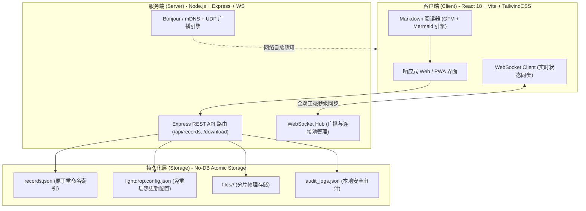

<p align="center">
  <picture>
    <source media="(prefers-color-scheme: dark)" srcset="./public/logo-dark.png">
    <source media="(prefers-color-scheme: light)" srcset="./public/logo.png">
    
  </picture>
</p>

<p align="center">
  <strong>现代化、极简、高隐私的局域网跨设备文件与文本共享服务</strong><br>
  无需公网中转 · 零外部数据库 · 纯 TypeScript 全栈 · PWA 原生支持 · 原生 Mermaid 图表渲染 · 毫秒级实时同步
</p>

<p align="center">
  <a href="./README.md">简体中文</a> | <a href="./README_EN.md">English</a>
</p>

<p align="center">
  
  
  
  
  
  
  
</p>

---

## 📖 目录

- [💡 项目亮点](#-项目亮点)
- [🌟 核心功能特性](#-核心功能特性)
  - [1. 📝 沉浸式 Markdown 阅读器与 Mermaid 图表引擎](#1--沉浸式-markdown-阅读器与-mermaid-图表引擎)
  - [2. 📁 多文件、文件夹递归压缩与图文合辑](#2--多文件文件夹递归压缩与图文合辑)
  - [3. 🔒 权限模式与安全解密体验](#3--权限模式与安全解密体验)
  - [4. 🔗 独立提取页与免密直达链接](#4--独立提取页与免密直达链接)
  - [5. ⚡ 毫秒级多端实时同步 (WebSocket)](#5--毫秒级多端实时同步-websocket)
  - [6. 🧽 经典海绵宝宝身份系统](#6--经典海绵宝宝身份系统)
  - [7. 💾 纯文件原子存储引擎 (No-DB)](#7--纯文件原子存储引擎-no-db)
  - [8. 🛡️ 本机专属操作审计日志 (Audit Logs)](#8-️-本机专属操作审计日志-audit-logs)
  - [9. 📱 PWA 原生跨平台体验](#9--pwa-原生跨平台体验)
  - [10. 🌐 局域网 IP 变动自愈与稳定域名发现](#10--局域网-ip-变动自愈与稳定域名发现)
- [🚀 快速开始](#-快速开始)
  - [方式一：Docker Compose（推荐）](#方式一docker-compose推荐)
  - [方式二：全平台智能运维部署脚本 (`deploy.sh` / `deploy.bat` / `deploy.ps1`)](#方式二全平台智能运维部署脚本-deploysh--deploybat--deployps1)
  - [方式三：本地源码运行](#方式三本地源码运行)
- [📐 架构设计与技术栈](#-架构设计与技术栈)
- [📦 自动化运维体系](#-自动化运维体系)
- [⚙️ 配置与数据持久化](#️-配置与数据持久化)
- [🛡️ 网络安全与企业局域网设计](#️-网络安全与企业局域网设计)
- [❓ 常见问题 (FAQ)](#-常见问题-faq)
- [🤝 参与贡献](#-参与贡献)
- [📄 开源协议](#-开源协议)

---

## 💡 项目亮点

<p align="center">
  
</p>

在跨设备文件与文本互传场景中，现有方案往往存在诸多痛点与限制：

| 方案 | 常见痛点 | LightDrop 优势 |
| :--- | :--- | :--- |
| **微信 / QQ / 钉钉** | 文件限速、图片视频严重压缩、敏感信息上传第三方公网云端 | **跑满局域网千兆/万兆带宽**，零外网流量消耗，数据 100% 物理留存本地 |
| **Apple AirDrop** | 强绑定苹果生态，无法与 Windows、Linux、Android 设备互通 | **全平台免装客户端**，任意设备只要有现代浏览器即可秒级互传 |
| **网盘 / 商业快传** | 强制注册登录、文件大小严苛受限、下载限速、需中间节点中转 | **零门槛即开即用**，局域网扫码秒连，支持 PWA 桌面/移动端安装 |
| **传统 Samba / FTP** | 搭建配置繁琐、移动端界面体验差、完全不具备富文本与代码协同能力 | **开箱即用**，现代响应式 UI，原生支持 Markdown 与 Mermaid 矢量图表 |

---

## 🌟 核心功能特性

### 1. 📝 沉浸式 Markdown 阅读器与 Mermaid 图表引擎
- **全功能沉浸式阅读器**：
  - 快速预览卡片与传输记录均提供一键 **「查看」**，呼出支持全屏平滑滚动的专用文档阅读器；
  - **双视图自由切换**：支持在 **渲染预览 (Preview)** 与 **纯文本源码 (Raw)** 之间无缝切换；
  - 完美兼容 **GitHub Flavored Markdown (GFM)**，包括复杂表格、任务列表、块引用与代码语法高亮。
- **原生 Mermaid 流程图与图表渲染**：
  - **丰富图表语法支持**：原生渲染 `flowchart` 流程图、`sequenceDiagram` 时序图、`classDiagram` 类图、`stateDiagram` 状态机、`erDiagram` 实体关系图、`gantt` 甘特图、`pie` 饼图、`gitGraph` 分支图、`mindmap` 思维导图等；
  - **图表交互工具栏**：自动识别图表类型并标注徽标，支持图表与源码双视图独立切换；
  - **一键复制代码 & 导出 SVG**：支持一键将图表源码复制到剪贴板，或直接导出高保真矢量 `.svg` 文件；
  - **超大画布全屏大图预览**：点击放大按钮唤起居中全屏模态框，轻松平移与检视大型复杂架构图；
  - **动态异步按需加载 (Code Splitting)**：未包含 Mermaid 的文档保持零额外网络负载，按需加载渲染模块；
  - **强隔离排版引擎 (CSS Reset)**：严格重置并隔离外层 Markdown 行高与内边距，从根本上杜绝文字溢出边框、中英文乱折行或行距失真。
- **智能多级目录 (TOC) 导航**：
  - 自动从 Markdown 标题中提取章节层级目录，支持一键展开/折叠与快速定位；
  - 点击目录项平滑滚动至对应章节，附带高亮淡出动效；
  - 右侧悬浮“回到目录”与“回到顶部”快捷按钮，顶部提供实时阅读进度指示条；
  - 支持一键导出/下载为标准 `.md` 文件，内置文件名合法化校验与自定义重命名。

### 2. 📁 多文件、文件夹递归压缩与图文合辑
- **批量拖拽极速互传**：支持多文件、海量图片一次性拖拽上传，动态展示精确传输进度、速度与分项元信息；
- **文件夹自动打包**：直接选择整个本地文件夹，服务端采用流式压缩（Streaming Zip）自动归档打包，完整保留多级层级结构；
- **图文合辑专属呈现**：支持在上传文件的同时附带说明文本或 Markdown 笔记，列表顶部优先渲染正文摘要与可折叠 Markdown，附件整洁汇聚；
- **高清缩略图与大图预览**：图片自动生成高清缩略图，点击呼出轻量画廊查看原图；
- **智能剪贴板集成**：支持在页面任意位置通过快捷键 `Ctrl+V` / `Cmd+V` 直接粘贴图片、文件或长文本，附带本地文件路径防呆检测。

### 3. 🔒 权限模式与安全解密体验
- **简明清晰的两种权限类型**：
  - **🌐 局域网公开**：免密公开，局域网内任意访客均可自由查看、复制正文与下载附件；
  - **🔒 PIN 密码保护**：受访问密码保护，服务端采用 SHA-256 加盐哈希脱敏，未验证前正文与文件下载直链均不向客户端泄露。
- **会话解密持久记忆**：成功解锁一条记录后，在当前浏览器会话周期内自动保持解锁状态，再次查看或复制**无需重复输入密码**，锁图标自动转换为可用状态。

### 4. 🔗 独立提取页与免密直达链接
- **单记录专属提取页 (`/download/:id`)**：
  - 每条记录分配专属短链接与二维码，手机微信或浏览器扫码直达单个条目，无需暴露主站仪表盘所有历史记录；
  - 针对文本记录提供优雅的卡片解锁过渡与阅读界面；
- **免密直达链接**：
  - 支持在分享链接中携带安全凭证参数（`?pwd=xxx`），接收方点击自动静默校验解锁；
  - 分享弹窗支持一键复制“图文分享文案”与“快捷免密直链”。

### 5. ⚡ 毫秒级多端实时同步 (WebSocket)
- 局域网内任意设备执行发送、修改、重命名、删除或清空操作，其余所有在线设备**无需手动刷新**，毫秒级全自动同步视图；
- 底部状态栏实时呈现当前局域网在线设备总数、延迟与服务健康状态。

### 6. 🧽 经典海绵宝宝身份系统
- 内置 15 位经典海绵宝宝角色库（海绵宝宝 🧽、派大星 ⭐️、章鱼哥 🐙、蟹老板 🦀 等），初次访问自动分发角色与专属 Emoji；
- 基于 `localStorage` 浏览器持久化，免去传统账号密码注册的繁琐，同时为发送记录、操作审计提供清晰直观的身份标识；
- 顶部导航支持随时自定义昵称或一键随机换角色。

### 7. 💾 纯文件原子存储引擎 (No-DB)
- **零外部数据库依赖**：无需安装 MySQL、PostgreSQL 或 Redis，采用 `records.json` 索引 + 物理文件目录隔离；
- **文件系统原子写入 (Atomic Write)**：通过临时文件与底层重命名（`fs.renameSync`）机制保障并发写入安全，防止意外断电导致数据损坏；
- **Web 端平滑热迁移**：系统设置中支持随时更改物理存储目录（如挂载的 NAS 或外部移动硬盘路径），支持**一键热迁移**历史数据，服务重启自动读取引导配置；
- **自动清理策略**：支持配置 1 天 / 3 天 / 7 天 / 30 天 或永不清理过期文件。

### 8. 🛡️ 本机专属操作审计日志 (Audit Logs)
- 仅在部署服务的本机（`localhost` / `127.0.0.1`）或受信任的管理员 IP 开放审计面板，局域网普通访客完全不可见；
- 全链路实时追踪局域网各客户端的上传、下载、复制、删除、查看密码及访问分享单页等操作轨迹。

### 9. 📱 PWA 原生跨平台体验
- 完整遵循 Web App Manifest 与 Service Worker 规范；
- 手机端支持“添加到主屏幕”，电脑端 Chrome / Edge / Safari 支持“安装应用”，拥有独立的运行窗口与原生 App 级操作质感。

### 10. 🌐 局域网 IP 变动自愈与稳定域名发现
- **Bonjour / mDNS 稳定本地域名**：系统自动生成 `http://<主机名>.local:8080` 稳定访问域名。宿主电脑无论切换到哪个 Wi-Fi，物理 IP 如何变动，手机添加到书签或主屏幕后**免重复扫码**，由底层 mDNS 协议秒级自动解析至最新物理 IP；
- **跨平台原生桌面通知**：电脑切换 Wi-Fi 时，自动触发系统级通知横幅（macOS 通知中心、Windows 原生 Toast、Linux `notify-send`），第一瞬间告知当前最新可用局域网 IP 与访问地址；
- **手机实时推送 (Bark / Webhook)**：设置中心支持填入 iOS Bark Key 或通用 Webhook 接收端，电脑切换 Wi-Fi 手机立即收到通知横幅，点击通知直接跳转进入最新服务；
- **UDP 自发现与连接断线自愈**：集成轻量 UDP 8089 端口广播信标，前端实时监听网络断线与 WebSocket 变动事件，网络恢复时静默重连与寻址自愈。

---

## 🚀 快速开始

### 方式一：Docker Compose（推荐）

**环境要求**：已安装 Docker 和 Docker Compose。

1. 克隆仓库并进入项目目录：

```bash
git clone https://github.com/zhatiai/LightDrop.git
cd LightDrop
```

2. 一键启动服务：

```bash
docker compose up -d
```

Docker Compose 将自动基于内置 `Dockerfile` 编译并启动服务，无需在宿主机安装 Node.js 或 pnpm。

打开浏览器访问 `http://<本机局域网IP>:8080` 即可开始使用。数据与文件将持久化存储在 `./data` 中。

后续更新代码只需执行：

```bash
git pull
docker compose up -d --build
```

---

### 方式二：全平台智能运维部署脚本 (`deploy.sh` / `deploy.bat` / `deploy.ps1`)

项目内置跨平台一键部署系统，**自动嗅探操作系统环境 (macOS / Linux / Windows)** 并动态匹配最优生命周期管理机制与开机自启动配置：

```bash
# === macOS / Linux / Windows (Git Bash) ===
# 交互式向导 (自动检测系统、适配模式与自启动选项)
./deploy.sh

# 自动选择系统最优原生模式并开启开机自启 (macOS 推荐)
./deploy.sh -m auto --autostart

# macOS 原生 LaunchAgent 守护服务 (免 root、崩溃自动恢复、开机自启)
./deploy.sh -m launchd --autostart

# Linux 原生 Systemd 系统服务
./deploy.sh -m systemd --autostart

# Docker 容器化部署 (全平台)
./deploy.sh -m docker -p 8080 --autostart
```

```powershell
# === Windows 原生 (PowerShell / CMD 双击) ===
# 双击 deploy.bat 或在 PowerShell 中执行:
.\deploy.ps1

# Windows 任务计划程序静默后台常驻 (推荐)
.\deploy.ps1 -Mode task -AutoStart $true

# Windows 开机自启文件夹模式 (免管理员权限)
.\deploy.ps1 -Mode startup -AutoStart $true
```

---

### 方式三：本地源码运行

**环境要求**：Node.js >= 18.0.0，pnpm >= 8.0.0

```bash
# 1. 安装全量依赖
pnpm install

# 2. 编译生产代码 (客户端 Vite + 服务端 TypeScript)
pnpm build

# 3. 启动生产服务
pnpm start

# 或进入开发热重载模式
pnpm dev
```

---

## 📐 架构设计与技术栈

本项目采用 **TypeScript 全栈单仓 (Monorepo) 规范**，前后端共享底层类型契约与协议定义：



### 目录结构组织

```text
LightDrop/
├── src/
│   ├── shared/                # 协议层：前后端共享 TypeScript 类型定义与常量
│   ├── server/                # 服务端：Express + WebSocket + 原子文件引擎 + mDNS 服务
│   └── client/                # 客户端：React 18 + Vite + Tailwind CSS + Mermaid + PWA
├── scripts/                   # 自动化运维脚本库 (deploy, package, uninstall, common)
├── Dockerfile                 # 多阶段瘦身生产容器构建文件
└── docker-compose.yml         # 生产容器编排文件
```

---

## 📦 自动化运维体系

| 脚本 | 适用平台 | 生命周期支持 | 常用指令示例 |
| :--- | :--- | :--- | :--- |
| `deploy.sh` / `deploy.bat` / `deploy.ps1` | macOS / Linux / Windows | **macOS**: `launchd` (LaunchAgent)<br>**Linux**: `systemd`<br>**Windows**: `task` / `startup`<br>**全平台**: `docker` / `pm2` / `standalone` | `./deploy.sh -m auto --autostart`<br>`.\deploy.ps1 -Mode task` |
| `package.sh` | Linux / macOS / Git Bash | 多形态发行打包 (Docker TAR 离线镜像 / 原生免编独立发行包) | `./package.sh --all` |
| `uninstall.sh` / `uninstall.bat` / `uninstall.ps1` | macOS / Linux / Windows | 精准停用服务、注销自启动项，支持数据保留或全量清除 | `./uninstall.sh --keep-data`<br>`.\uninstall.ps1 -DeleteData` |

---

## ⚙️ 配置与数据持久化

### 存储目录结构
数据默认持久化在 `./data`（或部署工作目录下的 `data` 路径）：

```text
data/
├── records.json               # 共享记录元数据 (内存索引加速 + 原子重命名覆写)
├── settings.json              # 系统运行首选项 (单文件限额、自动清理周期)
├── audit_logs.json            # 局域网操作审计日志
└── files/<recordId>/          # 上传的物理文件存储目录
```

### 独立配置文件与免重启热更新 (`lightdrop.config.json`)

系统提供独立的全局配置文件 `lightdrop.config.json`（位于部署工作目录，例如 macOS 原生服务为 `~/Library/Application Support/LightDrop/config/lightdrop.config.json`，源码运行则位于项目根目录）：

```json
{
  "storageDir": "/Users/user/data",
  "port": 8080,
  "maxFileSizeMB": 1024,
  "autoCleanupDays": 7,
  "siteTitle": "LightDrop",
  "adminIps": [
    "192.168.1.100",
    "10.0.0.*"
  ]
}
```

- **免重启热更新 (Hot-Reloading)**：直接编辑该 JSON 配置文件并保存，服务端底层文件监听器将**毫秒级自动热更新**并应用新策略，且通过 WebSocket 实时广播同步至所有已连接的设备界面，**完全无需重启服务进程**。
- **权限安全隔离 (Guest Read-Only / Admin)**：
  - 存储目录、单文件上传上限与自动清理策略为服务端全局配置；
  - 局域网内其他设备打开「设置」时，**所有服务器配置项均强制呈只读锁定状态**，界面呈现黄色访客标识，防止非管理员篡改；
  - 仅**部署服务器本机（回环地址及宿主机物理网卡）**或在 `adminIps` 列表中指定的管理员 IP 设备具备可写修改权限；
  - 部署脚本支持直接指定管理员 IP 列表：`./deploy.sh --admin-ips "192.168.1.100,10.0.0.*"`。

### 进程管理常用命令
- **macOS (launchd)**:
  ```bash
  launchctl unload -w ~/Library/LaunchAgents/com.lightdrop.server.plist && launchctl load -w ~/Library/LaunchAgents/com.lightdrop.server.plist
  ```
- **Linux (systemd)**:
  ```bash
  sudo systemctl restart lightdrop.service
  ```
- **PM2**:
  ```bash
  pm2 restart lightdrop
  ```
- **Docker**:
  ```bash
  docker restart lightdrop
  ```

---

## 🛡️ 网络安全与企业局域网设计

很多局域网工具在企业环境或大型 Wi-Fi 下容易引发 IT 审计关注或网络广播风暴担忧。LightDrop 从底层协议规范严格遵循**低频、单向、零污染**原则设计，天然适配企业内网：

### 1. 绝对杜绝“广播风暴” (Zero Broadcast Storm)
- **纯事件驱动（无定时轮询广播）**：服务端内部**没有任何定时轮询发包器**。仅在服务首次启动以及检测到网卡 IP 实际切换时触发**单次** UDP 信标，日常待机广播包发送量恒为 **0**；
- **微小数据包（单包 ~300 字节）**：单次通知耗时小于 0.1ms，仅相当于普通 ARP 请求包大小；
- **单向无放大、无环路**：接收端设备仅接收并更新本地内存，绝不参与任何转发或中继，物理上完全不具备触发广播风暴或环路放大的条件。

### 2. 链路本地（Link-Local）范围限制与企业 VLAN 隔离
- **mDNS 组播局限于物理二层**：Bonjour / mDNS 组播协议（`224.0.0.251:5353`）严格限制 TTL=1，仅在当前 Wi-Fi/广播域生效。三层核心交换机与企业路由器默认绝不路由或转播该组播包，**绝不会跨网段扩散至公司其他部门或核心服务器**；
- **兼容企业 AP 隔离 (Client Isolation)**：在开启了 AP 隔离的受控公司 Wi-Fi 下，无线 AP 会在空口或二层静默丢弃客户端间直连探测包。此时 UDP 信标与组播自然静默失效，不会对网络设施产生任何冲击或报警。

### 3. 企业严格合规模式（一键彻底关闭 UDP）
若公司信息安全或 EDR/态势感知审计策略严格禁止任何未经审批的 UDP 端口广播：
- 点击页面右上角 **「设置」->「局域网发现与 IP 变动感知」**；
- 直接**关闭「启用 UDP 局域网自发现」**开关，服务端将立即彻底销毁（`socket.close()`）UDP 8089 端口监听，不再发送或接收任何 UDP 数据包；
- 关闭后依然可以通过 `.local` 稳定域名、手机扫码或 Bark / Webhook 远程推送完整使用快传与 IP 自愈功能。

---

## ❓ 常见问题 (FAQ)

<details>
<summary><strong>Q: 手机扫码提示无法连接或超时？</strong></summary>

1. 确认手机与电脑连接在**同一 Wi-Fi** 下（处于同一局域网网段）；
2. 检查电脑系统防火墙是否已放行 `8080` 端口入站规则；
3. 若电脑启用了 VPN 或虚拟机虚拟网卡，点击顶部 IP 下拉框切换至真实的局域网 IPv4 地址。
</details>

<details>
<summary><strong>Q: Markdown 中包含复杂的 Mermaid 流程图或时序图能否正常展示？</strong></summary>

完全支持。LightDrop 内置专业级 Mermaid 渲染引擎与样式强隔离重置方案，无论是流程图（Flowchart）、时序图（Sequence）、类图（Class）、状态图（State）还是甘特图（Gantt）均能精确矢量渲染。支持图表/源码双视图切换、一键复制代码、导出 SVG 矢量图以及超大画布全屏大图预览。
</details>

<details>
<summary><strong>Q: 电脑切换 Wi-Fi 后，手机如何最快重新访问？</strong></summary>

系统提供 3 种极速感知与自愈方案：
1. **稳定域名（推荐）**：使用二维码弹窗中的 `http://<主机名>.local:8080` 稳定域名访问，手机直接「添加到主屏幕」或收藏为书签。电脑无论切换哪个 Wi-Fi，系统级 mDNS 均秒级自动将该域名解析至最新物理 IP，永久免换地址；
2. **桌面原生通知**：电脑切换 Wi-Fi 时，macOS / Windows / Linux 屏幕右上角会自动弹出桌面通知，清晰展示最新 IP；
3. **手机实时推送**：在设置中配置 iOS Bark URL，Wi-Fi 切换瞬间手机即刻收到通知弹窗，点击直接打开最新服务。
</details>

<details>
<summary><strong>Q: 该组件的 UDP 广播或组播会在公司局域网中引发广播风暴吗？</strong></summary>

绝对不会。
1. LightDrop 绝无定时广播循环，仅在 Wi-Fi 物理切换瞬间发送单个 300 字节的事件单包，频率比操作系统自带的 ARP/DHCP/AirDrop 后台网络行为低几个数量级；
2. mDNS 组播 TTL=1，仅在二层链路生效，三层企业路由器默认不转发，无法扩散至其他部门；
3. 若公司有严苛的内网合规审计，可在设置中一键彻底关闭「启用 UDP 局域网自发现」。
</details>

<details>
<summary><strong>Q: 上传超大文件是否有限制？</strong></summary>

原生无大小限制。系统采用流式写入机制，内存占用极低。如遇限额提示，可在右上角「设置」中将「单文件大小限制」调整为更大或设置为“无限制”。
</details>

<details>
<summary><strong>Q: 更改存储路径到 NAS 挂载目录后，重启会丢失吗？</strong></summary>

不会。工作目录下的 `lightdrop.config.json` 会持久记录当前生效的物理路径，服务重启后自动从引导配置定位目标目录。
</details>

<details>
<summary><strong>Q: 如何快捷分享带密码的文本并免去输入步骤？</strong></summary>

在记录的操作栏点击“复制链接”，弹窗内提供「快捷免密链接」（内含安全校验参数），接收者直接点击该链接即可自动验证并展开阅读。
</details>

<details>
<summary><strong>Q: 为什么手机端看不到“操作审计”入口？</strong></summary>

安全设计机制。局域网操作审计包含所有客户端行为留痕，仅开放给运行服务的本机（Localhost / 127.0.0.1）管理员访问，防止数据外泄。
</details>

---

## 🤝 参与贡献

欢迎提交 Issue 与 Pull Request！

1. Fork 本项目并克隆到本地
2. 创建特性分支 (`git checkout -b feature/awesome-feature`)
3. 提交改动 (`git commit -m 'feat: add awesome feature'`)
4. 推送到远程分支 (`git push origin feature/awesome-feature`)
5. 发起 Pull Request

---

## 📄 开源协议

本项目采用 [MIT 许可证](LICENSE) 开源，允许免费商用与自由二次分发。
