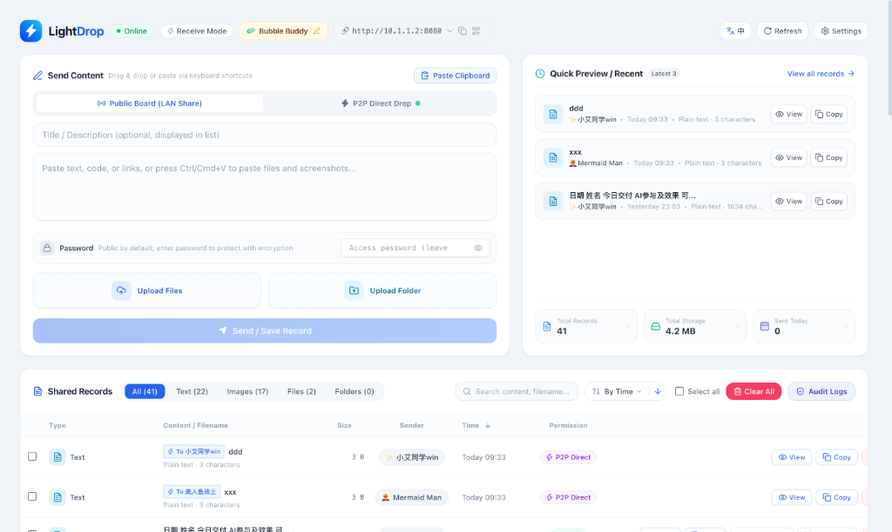
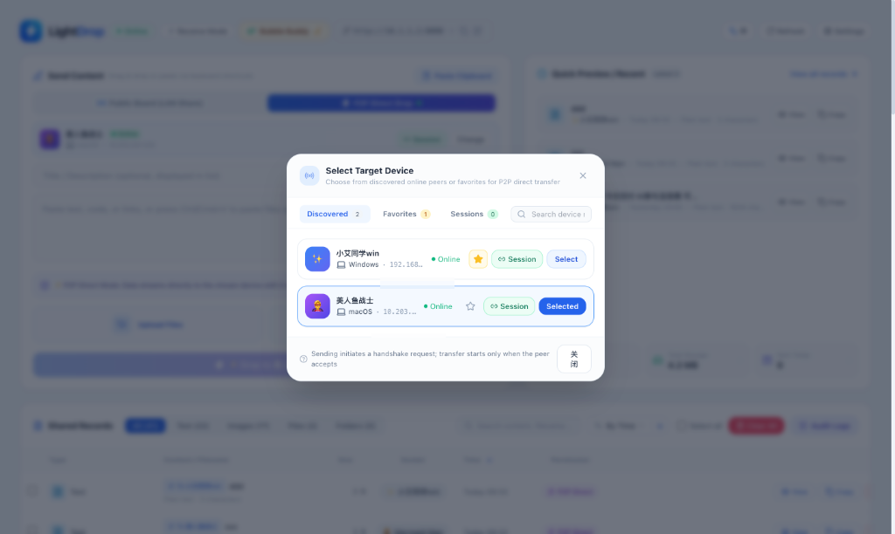
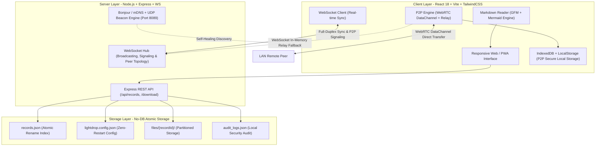

<p align="center">
  <picture>
    <source media="(prefers-color-scheme: dark)" srcset="./public/logo-dark.png">
    <source media="(prefers-color-scheme: light)" srcset="./public/logo.png">
    
  </picture>
</p>

<p align="center">
  <strong>Modern, Minimalist, Privacy-First Local Network (LAN) File & Text Sharing Service</strong><br>
  Zero Cloud Relays · No External Database · 100% Full-Stack TypeScript · Native PWA Ready · Native Mermaid Diagram Engine · Sub-Second WebSocket Sync
</p>

<p align="center">
  <a href="./README.md">English</a> | <a href="./README_ZH.md">简体中文</a>
</p>

<p align="center">
  
  
  
  
  
  
  
</p>

---

## 📖 Table of Contents

- [💡 Why LightDrop?](#-why-lightdrop)
- [🌟 Key Features](#-key-features)
  - [1. 📝 Immersive Markdown Reader & Native Mermaid Engine](#1--immersive-markdown-reader--native-mermaid-engine)
  - [2. 📁 Multi-File, Recursive Folder Packaging & Rich Bundles](#2--multi-file-recursive-folder-packaging--rich-bundles)
  - [3. 🔒 Streamlined Permission Model & Safe Decryption](#3--streamlined-permission-model--safe-decryption)
  - [4. 🔗 Standalone Extraction Pages & Direct Links](#4--standalone-extraction-pages--direct-links)
  - [5. ⚡ Sub-Second WebSocket Synchronization](#5--sub-second-websocket-synchronization)
  - [6. 🧽 Classic SpongeBob Identity System](#6--classic-spongebob-identity-system)
  - [7. 💾 No-DB Pure File Atomic Storage Engine](#7--no-db-pure-file-atomic-storage-engine)
  - [8. 🛡️ Host-Exclusive Audit Logs](#8-️-host-exclusive-audit-logs)
  - [9. 📱 Progressive Web App (PWA) Experience](#9--progressive-web-app-pwa-experience)
  - [10. 🌐 LAN IP Change Self-Healing & Stable Domain Discovery](#10--lan-ip-change-self-healing--stable-domain-discovery)
  - [11. 🚀 Peer-to-Peer (P2P) Direct Transfer & Dual-Channel Engine](#11--peer-to-peer-p2p-direct-transfer--dual-channel-engine)
- [🚀 Quick Start](#-quick-start)
  - [Method 1: Docker Compose (Recommended)](#method-1-docker-compose-recommended)
  - [Method 2: Smart Cross-Platform Deployment Scripts (`deploy.sh` / `deploy.bat` / `deploy.ps1`)](#method-2-smart-cross-platform-deployment-scripts-deploysh--deploybat--deployps1)
  - [Method 3: Build & Run from Source](#method-3-build--run-from-source)
- [📐 Architecture & Tech Stack](#-architecture--tech-stack)
  - [⚡ Deep Dive into P2P Technical Architecture](#-deep-dive-into-p2p-technical-architecture)
    - [1. P2P Device Discovery Mechanism](#1-p2p-device-discovery-mechanism)
    - [2. Connection Establishment & Signaling Protocol](#2-connection-establishment--signaling-protocol)
    - [3. High-Performance Dual-Channel Transmission & Flow Control](#3-high-performance-dual-channel-transmission--flow-control)
    - [4. P2P Resource Storage & Zero-Server Management Scheme](#4-p2p-resource-storage--zero-server-management-scheme)
  - [📚 Technical Architecture & Design Document Navigation](#-technical-architecture--design-document-navigation)
- [📦 DevOps Tooling](#-devops-tooling)
- [⚙️ Configuration & Data Persistence](#️-configuration--data-persistence)
- [🛡️ Network Safety & Enterprise Security](#️-network-safety--enterprise-security)
- [❓ Frequently Asked Questions (FAQ)](#-frequently-asked-questions-faq)
- [🤝 Contributing](#-contributing)
- [📄 License](#-license)

---

## 💡 Why LightDrop?

<p align="center">
  
</p>

Transferring files and text snippets between diverse devices on a local network has traditionally been frustrating:

| Solution | Major Pain Points | LightDrop Advantages |
| :--- | :--- | :--- |
| **Instant Messengers (Slack, WeChat, Teams)** | File size limits, lossy media compression, sensitive data uploaded to public clouds | **Saturates full Gigabit LAN bandwidth**, zero external internet consumption, 100% data remains strictly local |
| **Apple AirDrop** | Strictly bound to Apple ecosystem (iOS / macOS) | **Zero client installation**, operates instantly on any device with a modern web browser |
| **Cloud Storage (Google Drive, Dropbox)** | Mandatory account creation, strict quotas, slow uploads, public intermediary servers | **Zero sign-up required**, instant connection via LAN QR code, native PWA desktop/mobile installation |
| **Samba / FTP / NAS** | Complex configurations, poor mobile browser UX, lack of text and note sharing capabilities | **Zero-config out of the box**, modern responsive UI, native support for Markdown and Mermaid diagrams |

---

## 🌟 Key Features

### 1. 📝 Immersive Markdown Reader & Native Mermaid Engine
- **Full-Featured Distraction-Free Reader**:
  - One-click **"View"** in both the quick preview card and history records opens a full-screen, smooth-scrolling document viewer;
  - **Dual-View Seamless Toggle**: Effortlessly switch between **Rendered Preview** and **Raw Source**;
  - Full compatibility with **GitHub Flavored Markdown (GFM)**, including complex tables, checklists, blockquotes, and code syntax highlighting.
- **Native Mermaid Diagram & Flowchart Engine**:
  - **Comprehensive Diagram Support**: Natively renders `flowchart`, `sequenceDiagram`, `classDiagram`, `stateDiagram`, `erDiagram`, `gantt`, `pie`, `gitGraph`, `mindmap`, and more;
  - **Interactive Diagram Toolbar**: Automatically detects diagram types with clean tags; supports switching between diagram and source code;
  - **One-Click Copy & Export SVG**: Copy Mermaid source code with instant feedback, or export and download crisp, scalable vector `.svg` files;
  - **Canvas Fullscreen Preview**: Expand complex architecture blueprints into a centered modal dialog with smooth panning and deep zooming;
  - **Dynamic Lazy Loading (Code Splitting)**: Zero runtime impact on documents without diagrams; renders on demand;
  - **CSS Style Isolation & Reset**: Rigorously resets line heights and padding to eliminate font overflow, boundary clashes, and text wrapping issues.
- **Intelligent Table of Contents (TOC)**:
  - Automatically parses markdown heading hierarchies with collapsible navigation;
  - Smoothly scroll to target sections with subtle highlight fade animations;
  - Floating "Back to Top" and "Back to Outline" buttons with a top reading progress indicator;
  - Export and download notes directly as standard `.md` files with filename sanitization and custom rename support.

### 2. 📁 Multi-File, Recursive Folder Packaging & Rich Bundles
- **High-Speed Drag & Drop**: Drag multiple files and photo collections onto the dashboard with real-time transfer progress, speeds, and metadata;
- **Recursive Folder Auto-Packaging**: Select an entire local directory; the server streams and archives it into a standard ZIP package while preserving nested directories;
- **Rich Document & File Bundles**: Attach long explanatory text or Markdown notes alongside uploaded files. Explanatory summaries render at the top with collapsible content;
- **HD Thumbnails & Gallery View**: Automatic generation of sharp thumbnails with a lightweight gallery modal for full-resolution inspection;
- **Smart Clipboard Integration**: Press `Ctrl+V` / `Cmd+V` anywhere on the page to instantly paste images, files, or text, with built-in guardrails against accidental local file path drops.

### 3. 🔒 Streamlined Permission Model & Safe Decryption
- **Two Crystal-Clear Access Modes**:
  - **🌐 LAN Public**: Completely open to all local network devices without passwords;
  - **🔒 PIN Protected**: Secured with customizable access PINs. Server-side SHA-256 salted hashing ensures plain text and download links are completely hidden from unauthorized visitors.
- **Session Decryption Memory**: Once unlocked on a device, records remain decrypted within the active browser session. Subsequent viewing and copying **require zero repeated password prompts**, and lock icons seamlessly turn into ready actions.

### 4. 🔗 Standalone Extraction Pages & Direct Links
- **Isolated Extraction Routes (`/download/:id`)**:
  - Share single records via dedicated URLs and QR codes without exposing the global dashboard records;
  - Text records open in a specialized card and transition into the reader once unlocked;
- **Direct Password-Free Links**:
  - Supports appending security credentials (`?pwd=xxx`) to URLs for seamless, silent unlocking on recipient devices;
  - Share modal offers one-click copying for formatted descriptions and direct password-free links.

### 5. ⚡ Sub-Second WebSocket Synchronization
- Uploads, updates, renames, deletions, and batch wipes broadcast to all connected devices in real time—**no manual browser refreshing required**;
- Live count of active online devices, network latency, and service status displayed in the footer bar.

### 6. 🧽 Classic SpongeBob Identity System
- Includes 15 classic SpongeBob characters (SpongeBob 🧽, Patrick ⭐️, Squidward 🐙, Mr. Krabs 🦀, etc.), randomly assigned on initial visit;
- Persisted locally in `localStorage`—no registration needed, while giving each sender a distinct name and emoji badge across the network;
- Click the top navigation capsule to customize your display name or re-roll characters anytime.

### 7. 💾 No-DB Pure File Atomic Storage Engine
- **Zero Database Dependencies**: No MySQL, PostgreSQL, or Redis required. Operates using a lightweight `records.json` index + isolated directory storage;
- **Atomic File Operations**: Safe concurrent writes using temporary staging and atomic renames (`fs.renameSync`) to eliminate corruption during power cuts or high traffic;
- **Live Path Migration via Web UI**: Change your storage path (e.g., to a mounted NAS share) on the fly without stopping the service, with **one-click automated migration**;
- **Automated Retention Schedules**: Configure retention periods (1 day / 3 days / 7 days / 30 days / Never) for hands-off automatic cleanup.

### 8. 🛡️ Host-Exclusive Audit Logs
- The operation audit log is strictly restricted to the local host machine (`localhost` / `127.0.0.1`) and trusted admin IPs, remaining completely hidden from normal LAN visitors;
- Comprehensive audit trails tracking client IPs, usernames, upload/download events, copy actions, and PIN verification.

### 9. 📱 Progressive Web App (PWA) Experience
- Fully compliant with Web App Manifest and Workbox Service Worker specifications;
- Supports "Add to Home Screen" on mobile and "Install App" on desktop Chrome/Edge/Safari for standalone window execution.

### 10. 🌐 LAN IP Change Self-Healing & Stable Domain Discovery
- **Bonjour / mDNS Stable Local Domain**: Automatically generates `http://<hostname>.local:8080`. No matter how many times the host laptop switches Wi-Fi networks or how often the local IP changes, mobile devices bookmarking or adding this domain to Home Screen **never need to rescan the QR code**—system mDNS transparently resolves to the newest physical IP in sub-seconds;
- **Cross-Platform Native Desktop Notifications**: When the host machine connects to a new network, a native desktop notification pops up immediately (macOS Notification Center, Windows PowerShell Toast/Balloon, Linux `notify-send`) displaying the latest LAN IP and web link;
- **Real-Time Mobile Push Notifications (Bark / Webhook)**: Configure your iOS Bark Key or custom Webhook in Settings; your phone receives instant push alerts with clickable URLs whenever host Wi-Fi changes;
- **UDP Discovery Beacon & Disconnect Self-Healing**: Includes an ultra-lightweight UDP 8089 discovery beacon and WebSocket `NETWORK_CHANGED` broadcast, enabling clients to silently detect IP shifts and auto-reconnect without user intervention.

### 11. 🚀 Peer-to-Peer (P2P) Direct Transfer & Dual-Channel Engine

<p align="center">
  
</p>

- **LAN Device Auto-Discovery & Presence**: Automatically discovers peer devices on the same subnet, dynamically generating device cards with OS/browser badges, and supporting device favorites and persistent mutual-trust sessions;
- **WebRTC DataChannel Direct Transfer**: Establishes end-to-end encrypted tunnels (DTLS/SCTP) directly between peers to saturate full Gigabit/10G LAN bandwidth without hitting server disks, ensuring maximum privacy;
- **Intelligent Dual-Channel Fallback & 100% Reachability**: Seamlessly downgrades to a WebSocket in-memory streaming relay within 1.2s when encountering VLAN isolation or strict UDP firewall rules, guaranteeing 100% delivery across complex enterprise networks;
- **Strict Backpressure Control & 64KB Chunking**: Features 64KB streaming chunking and dual-sided backpressure control (256KB low threshold / 1MB high limit), pinning memory consumption strictly below 2MB with zero UI stutter or leaks;
- **IndexedDB Offline Persistence & Zero-Server Retention**: Transferred files and snippets bypass server disks entirely; the receiving browser automatically commits Blobs to IndexedDB for offline instant access and zero-network downloads.

---

## 🚀 Quick Start

### Method 1: Docker Compose (Recommended)

**Requirements**: Docker and Docker Compose.

1. Clone the repository:

```bash
git clone https://github.com/zhatiai/LightDrop.git
cd LightDrop
```

2. Start the service:

```bash
docker compose up -d
```

Docker Compose automatically builds the application using the included `Dockerfile` and starts the service. No manual installation of Node.js or pnpm is required.

Open `http://<YOUR_LAN_IP>:8080` in your browser. Uploaded files and application data are persisted in the `./data` directory.

To update the application:

```bash
git pull
docker compose up -d --build
```

---

### Method 2: Smart Cross-Platform Deployment Scripts (`deploy.sh` / `deploy.bat` / `deploy.ps1`)

LightDrop includes an intelligent deployment toolchain that **auto-detects your operating system (macOS / Linux / Windows)** and configures optimal lifecycle management and auto-start services:

```bash
# === macOS / Linux / Windows (Git Bash) ===
# Interactive wizard (auto-detects OS, guides deployment modes & autostart)
./deploy.sh

# Automatically choose best native daemon and enable autostart (Recommended for macOS)
./deploy.sh -m auto --autostart

# Native macOS LaunchAgent daemon (crash auto-restart, boot on login, no root needed)
./deploy.sh -m launchd --autostart

# Native Linux Systemd service
./deploy.sh -m systemd --autostart

# Docker containerized deployment (Cross-platform)
./deploy.sh -m docker -p 8080 --autostart
```

```powershell
# === Native Windows (PowerShell / CMD) ===
# Double-click deploy.bat or run via PowerShell:
.\deploy.ps1

# Windows Task Scheduler silent daemon (Recommended)
.\deploy.ps1 -Mode task -AutoStart $true

# Windows Startup folder mode (no administrator privileges needed)
.\deploy.ps1 -Mode startup -AutoStart $true
```

---

### Method 3: Build & Run from Source

**Requirements**: Node.js >= 18.0.0, pnpm >= 8.0.0

```bash
# 1. Install dependencies
pnpm install

# 2. Build production assets (Vite client + TypeScript server)
pnpm build

# 3. Start production server
pnpm start

# Or run in development mode with hot-reloading
pnpm dev
```

---

## 📐 Architecture & Tech Stack

LightDrop follows a **Full-Stack TypeScript Monorepo architecture**, sharing strict type definitions between frontend and backend:

> [!TIP]
> 📖 **Deep-Dive Specifications**: Looking for architectural panoramas, No-DB storage internals, WebSocket session handling, and P2P protocol details? Check out our dedicated guides: [System Architecture & Technical Design Document](./docs/architecture_EN.md) and [P2P Direct Transfer & Local Storage Technical Design Document](./docs/p2p-design_EN.md).



### ⚡ Deep Dive into P2P Technical Architecture

Given that web browsers operate inside sandboxed environments lacking native Raw UDP / broadcast socket capabilities, LightDrop designs a **two-tier, service-coordinated P2P transmission architecture**. Without requiring client installations or virtual network adapters, the system achieves sub-second device discovery, dual-channel adaptive data streaming, fine-grained backpressure flow control, and offline IndexedDB persistence.

#### 1. P2P Device Discovery Mechanism

Device discovery is architected into two decoupled tiers: **Service-Level Physical Network Discovery** and **Client-Level Browser Peer Topology Discovery**:

- **Service-Level Physical Network Discovery (UDP Beacon + mDNS)**:
  - **Active Beacon Announcement**: The server background service `UdpDiscoveryService` listens on `0.0.0.0:8089`. On cold startup or whenever physical network interfaces toggle, it broadcasts a `LIGHTDROP_ANNOUNCE` packet to `255.255.255.255:8089`, declaring its instance ID, IP, port, and Bonjour domain;
  - **Passive Probe Response**: Continually monitors incoming probe packets containing `DISCOVER`, `PING`, `SCAN`, or `QUERY`, unicasting a `LIGHTDROP_PONG` packet with server metadata;
  - **Broadcast Storm & Self-Echo Mitigation**: Each server process generates a unique `instanceId` to discard self-echo packets. Rate-limiting restricts responses to the same client IP to at most once per 500ms, and a 5-second TTL cache for network interfaces prevents frequent kernel system calls and CPU spikes.
- **Client-Level Browser Peer Topology Discovery (WebSocket Hub)**:
  - **Persistent Device Fingerprinting**: Each client generates a globally unique and stable `deviceId` (e.g. `node_<timestamp>_<random>`) stored in `localStorage`, bundled with its OS, browser family, SpongeBob avatar, and operating mode (e.g. Receive Mode);
  - **Online Declaration (`PEER_REGISTER`)**: Upon opening the WebSocket connection, the browser immediately submits a `PEER_REGISTER` event. The server captures the real underlying socket client IP (`clientIp`) and enriches the peer info;
  - **Full Snapshot Unicast + Incremental Broadcast**:
    - **Full Snapshot Unicast**: The server only unicasts the active peer list (`PEER_ONLINE_LIST`, excluding self) to the newly connected node, preventing wasteful network floods;
    - **Incremental Broadcast**: Other online peers receive a lightweight `PEER_JOINED` event. Attribute updates trigger `PEER_UPDATED`, and disconnections detected via 30s keep-alive pings trigger `PEER_LEFT`. Topology traffic is minimized to sub-millisecond, sub-hundred-byte JSON events.

#### 2. Connection Establishment & Signaling Protocol

Prior to data transfer, the system orchestrates mutual-consent handshakes, unicast signaling relay, and adaptive channel negotiation:

- **Session Models & Handshake Protocols**:
  - **Lightweight Single-Transfer Handshake**: The sender dispatches a `HANDSHAKE_REQUEST` containing file manifests, previews, total bytes, and sender fingerprint. The recipient inspects the interactive modal and returns a `HANDSHAKE_RESPONSE` (`accepted` / `rejected` / `busy` / `timeout`);
  - **Persistent Mutual-Trust Session**: Peers can establish a long-lived mutual session (`SESSION_REQUEST` -> `SESSION_ESTABLISHED`). Active sessions bypass repetitive handshakes and unlock **0-RTT Instant Unidirectional Text Dispatch (`SESSION_DIRECT_TEXT`)**;
  - **Strict Unicast Signaling Relay**: All session handshakes, SDP Offers/Answers, and ICE Candidates are encapsulated as `P2P_DIRECT_MESSAGE` and routed strictly by `targetDeviceId` through WebSocket memory. Unrelated nodes remain completely untouched.
- **1.2s Adaptive Dual-Channel Negotiation**:
  - During handshake initiation, the engine initializes an `RTCPeerConnection` with STUN candidates and creates an `RTCDataChannel` (`ordered: true`, binary type `arraybuffer`);
  - **Fallback Timeout**: A 1200ms timeout window is allotted for LAN hole punching. If the DataChannel opens successfully within 1.2s, the mode locks into `webrtc` (DTLS/SCTP end-to-end encryption, maxing out LAN speeds). If cross-subnet routing, symmetric NAT, or strict corporate firewalls block UDP, the engine **seamlessly downgrades to `relay` mode** (streaming via the existing WebSocket in-memory tunnel), ensuring 100% transfer success.

#### 3. High-Performance Dual-Channel Transmission & Flow Control

To overcome memory spikes, buffer bloat, and browser tab freezes during large-file transfers, the P2P engine implements a strict streaming pipeline:

- **64KB Streaming Chunking**:
  - File reading avoids loading entire files into memory; it reads 64KB slices sequentially using `File.slice(offset, offset + 64KB)` as `ArrayBuffer`;
  - Binary chunks are sent natively over WebRTC DataChannel, or converted to Base64 chunks over the WebSocket relay.
- **Dual-Sided Backpressure Control**:
  - **WebRTC Backpressure**: Monitors DataChannel buffer depth `dc.bufferedAmount`. When exceeding 1MB, sending halts until `onbufferedamountlow` triggers at the 256KB low-water mark;
  - **WebSocket Backpressure**: Monitors `activeWs.bufferedAmount`. If outbound buffers accumulate above 512KB, the loop yields via `waitForWsDrain`;
  - System memory consumption is strictly pinned at **< 2MB**, completely eliminating out-of-memory (OOM) browser crashes.
- **True Outbound NIC Rate Measurement**:
  - Real-time speeds and progress compute only bytes actually flushed from the network card (`actualDeliveredBytes = transferredBytes - buffered`), eliminating false 100% progress indications where data remains trapped in local socket buffers.
- **Dual-Sided ACK Confirmation & Disk Assembly Sync**:
  - During transfer, the receiver throttles progress ACKs (`TRANSFER_ACK`) back to the sender every 300ms or 256KB for precision alignment;
  - **Final Completion Handshake**: The sender caps progress at 99% upon emitting all bytes. Only after the receiver verifies and commits all blobs to local storage and returns a `TRANSFER_COMPLETE_ACK` does the sender trigger its 100% completion callback, preventing single-sided hanging states.

#### 4. P2P Resource Storage & Zero-Server Management Scheme

LightDrop P2P strictly enforces a **zero-server retention and local-first privacy** architecture:

- **Zero-Server-Disk-Retention**:
  - P2P files and text snippets **never touch the server's disk storage** (they are never written to `data/files/` or `records.json`), leaving zero server-side logs or traces.
- **Hybrid Local Persistence**:
  - **Lightweight Metadata Layer (`localStorage`)**: Stores transfer summaries (`lightdrop_p2p_records` including transferId, peer nickname, avatar, timestamp, file counts, and sizes). These entries blend seamlessly into the main records table adorned with a prominent `P2P` badge;
  - **Binary Blob Layer (`IndexedDB`)**: Once a transfer finishes (`completeP2PRecord`), binary blobs are committed into browser-local IndexedDB (`LightDrop_P2P_DB` -> `blobs` store, keyed by `${recordId}_${fileIndex}`). This bypasses the 5MB `localStorage` limit, supporting hundreds of megabytes or gigabytes of offline storage.
- **Zero-Network Blob Export & Download**:
  - When users view or download a P2P item, the records hook (`useRecords`) intercepts the `isP2P` flag, retrieves the Blob from IndexedDB via `getP2PRecordBlob()`, and triggers a native download via `URL.createObjectURL`; **0 external network bandwidth or server compute is consumed**.
- **Atomic Lifecycle Management**:
  - **Cascading Deletion**: Deleting a single P2P record atomically clears its `localStorage` index and purges all corresponding `IndexedDB` blobs;
  - **Batch Clear**: Supports one-click purging of all local P2P cache via `clearAllLocalP2PRecords`;
  - **Private Browsing Isolation**: Incognito mode or clearing website data instantly purges all P2P assets without leaving trace evidence on the host.

### 📚 Technical Architecture & Design Document Navigation

For developers and system architects seeking an in-depth understanding of LightDrop's internal design, storage models, and protocol pipelines, comprehensive technical specifications are available in the [`docs/`](./docs) directory:

| Document | Languages | Core Coverage |
| :--- | :--- | :--- |
| 📘 **System Architecture & Technical Design** | [English](./docs/architecture_EN.md) · [简体中文](./docs/architecture.md) | Multi-tier topology, No-DB atomic rename engine, WebSocket connection pools, LAN IP self-healing, and enterprise security models |
| 🚀 **P2P Direct Transfer & Local Storage Technical Design** | [English](./docs/p2p-design_EN.md) · [简体中文](./docs/p2p-design.md) | Two-tier discovery, WebRTC/Relay 1.2s adaptive negotiation, 64KB backpressure pipeline, and IndexedDB zero-server persistence |
| 🛠️ **Remote Server Deployment Bug Report** | [Issue Retrospective](./docs/bug.md) | Comprehensive test coverage on Ubuntu 22.04 LTS, cross-platform shell compatibility analysis, and post-mortem fixes for 12 critical bugs |

### Directory Structure

```text
LightDrop/
├── src/
│   ├── shared/                # Shared: TypeScript types, contracts, and constants
│   ├── server/                # Backend: Express + WebSocket + Atomic storage + mDNS
│   └── client/                # Frontend: React 18 + Vite + Tailwind CSS + Mermaid + PWA
├── scripts/                   # Automated DevOps scripts (deploy, package, uninstall, common)
├── Dockerfile                 # Multi-stage production container specification
└── docker-compose.yml         # Container orchestration specification
```

---

## 📦 DevOps Tooling

| Script | Supported OS | Lifecycle Managers | Example Commands |
| :--- | :--- | :--- | :--- |
| `deploy.sh` / `deploy.bat` / `deploy.ps1` | macOS / Linux / Windows | **macOS**: `launchd` (LaunchAgent)<br>**Linux**: `systemd`<br>**Windows**: `task` / `startup`<br>**Cross-Platform**: `docker` / `pm2` / `standalone` | `./deploy.sh -m auto --autostart`<br>`.\deploy.ps1 -Mode task` |
| `package.sh` | Linux / macOS / Git Bash | Multi-format distribution bundler (Offline Docker TAR / Native standalone archive) | `./package.sh --all` |
| `uninstall.sh` / `uninstall.bat` / `uninstall.ps1` | macOS / Linux / Windows | Clean service uninstaller, removes autostart registrations with optional data retention | `./uninstall.sh --keep-data`<br>`.\uninstall.ps1 -DeleteData` |

---

## ⚙️ Configuration & Data Persistence

### Storage Directory Layout
Data defaults to `./data` (or the configured `data` path inside your working directory):

```text
data/
├── records.json               # Shared record metadata (in-memory index + atomic overwrite)
├── settings.json              # System preferences (file limits, cleanup intervals)
├── audit_logs.json            # Local LAN operation audit trail
└── files/<recordId>/          # Physical storage directory for uploaded files
```

### Standalone Configuration & Zero-Restart Hot Reloading (`lightdrop.config.json`)

The system provides an isolated global configuration file `lightdrop.config.json` (located in the installation directory, e.g. `~/Library/Application Support/LightDrop/config/lightdrop.config.json` for macOS launchd, or the repository root when running from source):

```json
{
  "storageDir": "/Users/user/data",
  "port": 8080,
  "maxFileSizeMB": 1024,
  "autoCleanupDays": 7,
  "siteTitle": "LightDrop",
  "adminIps": [
    "192.168.1.100",
    "10.0.0.*"
  ]
}
```

- **Zero-Restart Hot-Reloading**: Directly edit and save this file anytime. The filesystem watcher applies updates within milliseconds and broadcasts them via WebSocket—**zero process restarts required**.
- **Role-Based Security Isolation (Guest Read-Only / Admin)**:
  - Storage paths, upload limits, and auto-cleanup policies apply globally;
  - Visiting the Settings modal from other LAN devices shows all server configuration fields **locked in read-only mode** with a warning badge;
  - Only the **host machine (`localhost` / `127.0.0.1`)** or clients with IPs matched in `adminIps` have write authorization;
  - Configure admin IPs during deployment: `./deploy.sh --admin-ips "192.168.1.100,10.0.0.*"`.

### Process Management Commands
- **macOS (launchd)**:
  ```bash
  launchctl unload -w ~/Library/LaunchAgents/com.lightdrop.server.plist && launchctl load -w ~/Library/LaunchAgents/com.lightdrop.server.plist
  ```
- **Linux (systemd)**:
  ```bash
  sudo systemctl restart lightdrop.service
  ```
- **PM2**:
  ```bash
  pm2 restart lightdrop
  ```
- **Docker**:
  ```bash
  docker restart lightdrop
  ```

---

## 🛡️ Network Safety & Enterprise Security

Traditional LAN file-sharing tools frequently raise concerns among IT administrators regarding broadcast storms or unauthorized scanning. LightDrop is architected strictly under the **low-frequency, unidirectional, zero-pollution** paradigm:

### 1. Zero Broadcast Storm Guarantee
- **Event-Driven Only**: Contains **no background periodic broadcast loops**. UDP discovery beacons trigger **once** during startup and network change events. In idle state, broadcast packets per second is strictly **0**;
- **Lightweight Payloads (~300 bytes)**: Each packet consumes less than 0.1ms of transmission time, comparable to a standard ARP probe;
- **Non-Relaying Architecture**: Client devices only update their local routing tables and never retransmit or relay discovery packets.

### 2. Link-Local Scope & VLAN Isolation
- **mDNS Bound to Layer 2**: Bonjour/mDNS multicast (`224.0.0.251:5353`) is strictly bounded by TTL=1. Enterprise core routers and Layer 3 switches will never forward packets beyond the local subnet or corporate boundaries;
- **Enterprise AP Client Isolation**: In hardened office Wi-Fi networks with client isolation active, APs silently discard direct peer packets. Multicast safely degrades without generating alerts on network monitoring tools.

### 3. Enterprise Strict Compliance Mode
For environments with strict security policies prohibiting UDP beacons:
- Navigate to **"Settings" -> "LAN Discovery & IP Awareness"**;
- Toggle off **"Enable UDP LAN Auto-Discovery"**. The server closes the socket immediately (`socket.close()`) on port 8089 and ceases all UDP activity;
- The service remains 100% accessible via `.local` domain names, QR codes, or Bark / Webhook push notifications.

---

## ❓ Frequently Asked Questions (FAQ)

<details>
<summary><strong>Q: Mobile device fails to connect after scanning the QR code?</strong></summary>

1. Ensure your mobile device and computer are connected to the **same Wi-Fi network** (same subnet);
2. Verify that your host firewall allows incoming traffic on port `8080`;
3. If running VPNs or virtual machine network adapters, click the top IP dropdown to select the actual physical IPv4 address.
</details>

<details>
<summary><strong>Q: Does it support complex Mermaid flowcharts or sequence diagrams in Markdown?</strong></summary>

Yes, out of the box. LightDrop incorporates a dedicated Mermaid rendering engine with CSS isolation. Flowcharts, sequence diagrams, class models, state machines, and Gantt charts render cleanly as vector graphics. Features include dual diagram/code views, one-click code copy, SVG download, and fullscreen canvas inspection.
</details>

<details>
<summary><strong>Q: How can mobile devices reconnect fastest after the laptop changes Wi-Fi networks?</strong></summary>

LightDrop provides 3 self-healing mechanisms:
1. **Stable Domain (Recommended)**: Connect via `http://<hostname>.local:8080` and add to Home Screen. Operating-system-level mDNS automatically resolves to the latest IP across network switches;
2. **Native Desktop Notifications**: When Wi-Fi changes, a desktop notification banner displays the new connection URL;
3. **Mobile Push Notifications**: Enter your iOS Bark Key in Settings to receive clickable notifications immediately upon network transitions.
</details>

<details>
<summary><strong>Q: Will UDP broadcasts trigger enterprise IDS or broadcast alarms?</strong></summary>

No. LightDrop uses no recurring polling loops—only single 300-byte packets sent upon physical network changes. Furthermore, mDNS is restricted to Layer 2 (TTL=1), and UDP discovery can be disabled completely with one click in Settings.
</details>

<details>
<summary><strong>Q: Is there a maximum file size limit for uploads?</strong></summary>

There is no inherent engine limit. The server utilizes streaming uploads with minimal memory footprints. If you encounter limits, adjust or disable the "Max File Size" slider in Settings.
</details>

<details>
<summary><strong>Q: Will changing the storage path to a NAS mount persist across restarts?</strong></summary>

Yes. The effective storage path is written to `lightdrop.config.json` and automatically loaded on server boot.
</details>

<details>
<summary><strong>Q: How do I share password-protected text without requiring manual entry?</strong></summary>

Click "Copy Link" in the record's actions menu and select "Quick Password-Free Link". The recipient simply opens the link to automatically authenticate and read the content.
</details>

<details>
<summary><strong>Q: Why can't I see the "Audit Logs" entry from my smartphone?</strong></summary>

By design. The audit log contains comprehensive client activity trails and is accessible only from the local host (`localhost` / `127.0.0.1`) or explicitly configured admin IPs.
</details>

---

## 🤝 Contributing

Contributions, issues, and feature requests are welcome!

1. Fork the repository
2. Create a feature branch (`git checkout -b feature/awesome-feature`)
3. Commit your changes (`git commit -m 'feat: add awesome feature'`)
4. Push to the branch (`git push origin feature/awesome-feature`)
5. Open a Pull Request

---

## 📄 License

This project is licensed under the [MIT License](LICENSE).
