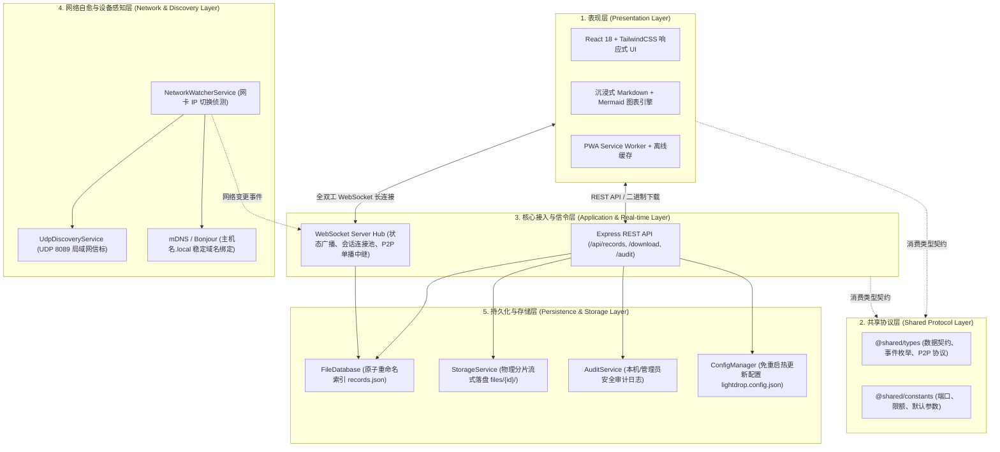
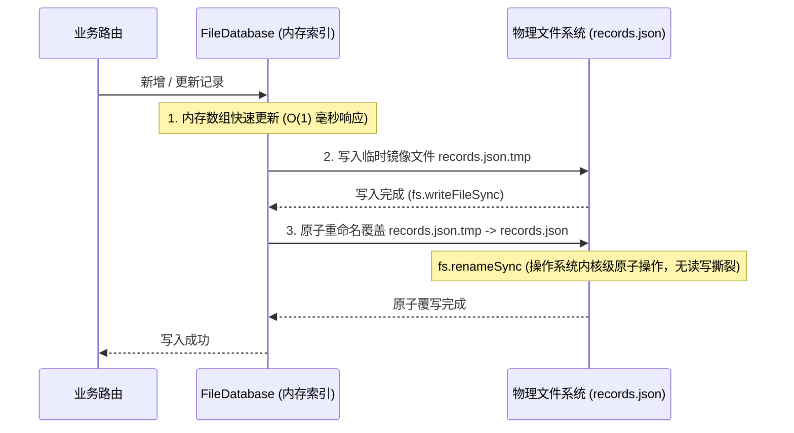

# LightDrop 系统技术架构与详细设计文档

> **版本**: v1.0.0  
> **语言**: 简体中文 | [English Version](./architecture_EN.md)  
> **更新时间**: 2026-10-30  
> **相关文档**: [P2P 点对点传输与资源存储技术设计文档](./p2p-design.md) | [部署与缺陷测试报告](./bug.md)

---

## 📖 目录

- [1. 架构愿景与设计哲学](#1-架构愿景与设计哲学)
- [2. 整体分层架构模型](#2-整体分层架构模型)
- [3. 前端工程化与表现层设计](#3-前端工程化与表现层设计)
- [4. 服务端架构与核心引擎设计](#4-服务端架构与核心引擎设计)
  - [4.1 No-DB 纯文件原子存储引擎](#41-no-db-纯文件原子存储引擎)
  - [4.2 WebSocket 全双工状态机与连接池](#42-websocket-全双工状态机与连接池)
  - [4.3 局域网网络自愈与 IP 漂移感知](#43-局域网网络自愈与-ip-漂移感知)
- [5. 企业级安全与权限模型](#5-企业级安全与权限模型)
- [6. Markdown 阅读器与 Mermaid 图表引擎设计](#6-markdown-阅读器与-mermaid-图表引擎设计)
- [7. 自动化运维与多环境部署架构](#7-自动化运维与多环境部署架构)

---

## 1. 架构愿景与设计哲学

在局域网跨设备协同与文件分发场景中，传统方案往往面临**公网中转隐私泄露、跨平台系统生态割裂、部署依赖沉重（需外挂 MySQL/Redis）**等痛点。LightDrop 确立了四大核心设计哲学：

1. **零外部数据库依赖 (Zero-External-DB)**：全系统基于 Node.js 原生文件系统实现原子持久化，启动即用，免去数据库运维、连接池管理与备份迁移心智负担。
2. **纯前端/浏览器原生交付 (Web-Native)**：用户设备（手机、平板、电脑）无需安装任何专用客户端或虚拟网卡驱动，只要有现代浏览器即可毫秒级接入。
3. **全栈 TypeScript 契约一致性 (Single-Source-of-Truth)**：前端与后端共享协议层类型定义与常量定义，彻底杜绝接口联调中的类型漂移与隐式序列化 Bug。
4. **极致隐私与本地留存 (Local-First & High Privacy)**：普通分享物理留存本地私有网络，P2P 直传更实现**零服务端磁盘驻留**，数据 100% 物理掌握在用户手中。

---

## 2. 整体分层架构模型

LightDrop 采用清晰的五层拓扑设计，确保模块间高内聚、低耦合：

---

## 3. 前端工程化与表现层设计

* **技术选型**：React 18、Vite、TypeScript、Tailwind CSS、Lucide Icons、i18next。
* **状态管理范式**：
  * 基于 React Hooks 实现清晰的职责切分：`useRecords`（公共记录管理）、`useWebSocket`（底层长连接复用与流控）、`useP2P`（点对点直连状态机）；
  * 引入 `CustomEvent` 驱动的全局事件总线（如 `lightdrop:p2p-records-changed`、`lightdrop:nickname-changed`），实现解耦的跨组件响应。
* **PWA 原生容器化**：
  * 集成 `vite-plugin-pwa`，自动配置 Web App Manifest；
  * 具备 Service Worker 静态资源预缓存，手机端支持无边框全屏运行，桌面端支持独立窗口应用级体验。

---

## 4. 服务端架构与核心引擎设计

### 4.1 No-DB 纯文件原子存储引擎

为了在无外部数据库的情况下提供强一致性与高吞吐并发保障，[`FileDatabase`](../src/server/database/file.database.ts) 采用了**「内存索引加速 + 临时文件原子覆写（Atomic Rename）」**策略：

* **原子覆写保障**：直接调用操作系统底层的 `renameSync`，在 POSIX 系统与 Windows 系统上均具备原子性。即使在写盘瞬间发生宿主机断电或进程强杀，目标 `records.json` 也绝不会出现截断损坏（Half-written JSON）。
* **流式压缩归档**：面对多文件及文件夹递归上传，服务端采用 `archiver` 流式打包，边读取边压缩输出，内存占用恒定，避免一次性在内存中堆积巨大 Zip Buffer。

### 4.2 WebSocket 全双工状态机与连接池

系统通过单套 WebSocket 服务（[`ws.server.ts`](../src/server/websocket/ws.server.ts)）实现高效的广播、组播与单播路由：
* **全量与增量结合**：新节点注册（`PEER_REGISTER`）时单播下发全量在线设备快照；设备上线、修改状态、离线时仅广播细粒度的增量变动事件（`PEER_JOINED` / `PEER_UPDATED` / `PEER_LEFT`）；
* **心跳探活与连接自愈**：
  * 服务端以 30 秒为周期遍历 `clients` 连接池发送 `ping`，无应答连接执行 `ws.terminate()` 强行释放；
  * 客户端内置 1.5 秒快速指数重连保护，并在断线后自动重置状态机。

### 4.3 局域网网络自愈与 IP 漂移感知

在移动办公环境下，电脑常在不同 Wi-Fi 间切换，导致局域网 IP 频繁变动：
* **物理网卡监听**：[`NetworkWatcherService`](../src/server/services/network-watcher.service.ts) 定期计算当前活跃物理网卡 IPv4 的哈希签名，纳秒级比对。
* **Bonjour / mDNS 稳定域名解析**：结合系统底层的 `LocalHostName`，生成 `http://<主机名>.local:8080` 稳定访问地址。手机一次扫码加入书签后，物理 IP 变更也能通过 mDNS 协议秒级自愈解析。
* **主动多端推送**：检测到网络变动时，服务端立即通过 WebSocket 广播最新 IP、触发 UDP 广播信标更新，并通过 macOS / Windows / Linux 原生桌面通知及 iOS Bark / Webhook 推送通知用户。

---

## 5. 企业级安全与权限模型

LightDrop 兼顾了局域网即开即用的便捷性与企业网络接入的安全性：

1. **宿主机与管理员权限隔离**：
   * 采用反向代理与容器网关识别算法，智能判断访问来源是否为本机回环（`127.0.0.1` / `::1`）、宿主机物理 IP 或 Docker 默认网桥网关（`172.17.0.1`）；
   * 局域网普通访客打开设置界面时，核心配置项强制呈只读锁定状态，防止非管理员篡改；管理员可通过 `lightdrop.config.json` 中的 `adminIps` 字段指定受信任的管理 IP 段。
2. **免重启热更新配置 (`lightdrop.config.json`)**：
   * 配置文件与运行数据完全分离；
   * 修改存储路径、最大单文件体积（MB）、自动清理周期（天）保存后，底层监听器在毫秒级内重载配置并广播同步，免除停机重启。
3. **安全提取模式与密码保护**：
   * 敏感记录支持配置密码，服务端以 SHA-256 存储密码哈希；
   * 密码校验具备防暴力破解限制，提供专属的独立免密直达 Token 链接。

---

## 6. Markdown 阅读器与 Mermaid 图表引擎设计

* **动态异步按需加载 (Code Splitting)**：
  * Mermaid 核心图表库体积较大，系统采用 Vite 动态 `import()` 进行代码分割，未包含 Mermaid 代码块的普通 Markdown 笔记保持零额外加载开销。
* **样式隔离沙箱 (CSS Reset)**：
  * 强制隔离外部 Markdown 排版样式对 SVG 图表内部字体、行距与内边距的污染，杜绝中文文本换行截断与连线错位。
* **全屏大图画布与矢量导出**：
  * 原生支持点击放大模态框，轻松拖拽检视大型架构图；支持一键将当前图表导出为高质量矢量 `.svg` 文件。

---

## 7. 自动化运维与多环境部署架构

项目配备全平台一体化部署系统：
* **跨平台部署脚本**（`deploy.sh` / `deploy.bat` / `deploy.ps1`）：
  * **macOS**：原生注册 `launchd` 用户级守护进程（`~/Library/LaunchAgents/`），崩溃秒级拉起，开机自启；
  * **Linux**：原生注册 `systemd` 系统服务；
  * **Windows**：支持“任务计划程序静默常驻”与“开机启动文件夹”免管理员模式；
  * **容器化**：多阶段极简构建 `Dockerfile` 与 `docker-compose.yml`，宿主机零依赖直接运行。
* **离线打包流水线**（`package.sh`）：支持一键打包跨平台免编译离线便携包与 Docker 离线镜像 TAR 包。
