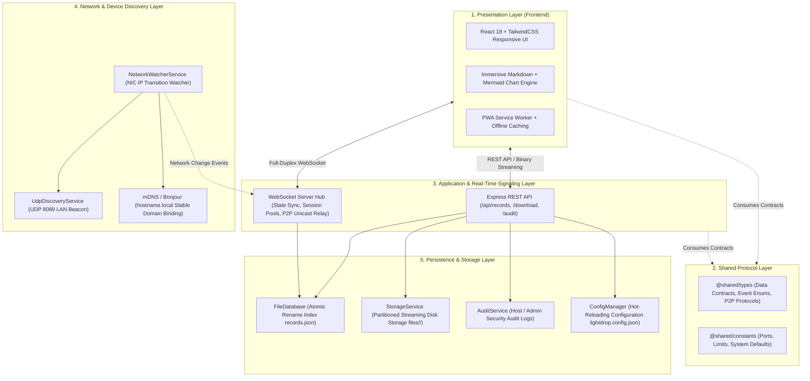

# LightDrop System Architecture & Technical Design Document

> **Version**: v1.0.0  
> **Language**: English | [简体中文](./architecture.md)  
> **Last Updated**: 2026-10-30  
> **Related Documents**: [P2P Direct Transfer & Local Storage Technical Design](./p2p-design_EN.md) | [Remote Deployment Bug Report](./bug.md)

---

## 📖 Table of Contents

- [1. Architectural Vision & Core Philosophy](#1-architectural-vision--core-philosophy)
- [2. Multi-Tier System Layering](#2-multi-tier-system-layering)
- [3. Frontend Engineering & Presentation Layer](#3-frontend-engineering--presentation-layer)
- [4. Backend Architecture & Core Engines](#4-backend-architecture--core-engines)
  - [4.1 No-DB Pure File Atomic Storage Engine](#41-no-db-pure-file-atomic-storage-engine)
  - [4.2 Full-Duplex WebSocket State Machine & Session Pool](#42-full-duplex-websocket-state-machine--session-pool)
  - [4.3 LAN Network Self-Healing & Dynamic IP Detection](#43-lan-network-self-healing--dynamic-ip-detection)
- [5. Enterprise-Grade Security & Permission Model](#5-enterprise-grade-security--permission-model)
- [6. Markdown Reader & Native Mermaid Engine Design](#6-markdown-reader--native-mermaid-engine-design)
- [7. Automated DevOps & Multi-Environment Deployment](#7-automated-devops--multi-environment-deployment)

---

## 1. Architectural Vision & Core Philosophy

In traditional local network file sharing and multi-device collaboration, developers and users typically suffer from **public cloud privacy leak risks, ecosystem fragmentation (e.g., Apple AirDrop exclusivity), and heavy external dependencies (such as MySQL or Redis requirements)**. LightDrop was engineered on four foundational design principles:

1. **Zero-External-DB Dependency**: Built entirely on top of Node.js native filesystem atomic primitives. It launches instantly with zero database setup, connection pool tuning, or migration overhead.
2. **Web-Native Delivery**: Zero client software, kernel extensions, or virtual network adapters required. Any smartphone, tablet, or PC with a modern browser can collaborate in milliseconds.
3. **Full-Stack TypeScript Contract Rigor**: Shared contract definitions across frontend and backend eradicate schema drift and implicit serialization bugs.
4. **Local-First & Absolute Privacy**: Standard shared data stays strictly within the local physical network. P2P transfers go further by maintaining **zero server-side disk footprints**, keeping data 100% under user control.

---

## 2. Multi-Tier System Layering

LightDrop adopts a clean five-layer architecture ensuring high cohesion and low coupling:



---

## 3. Frontend Engineering & Presentation Layer

* **Technology Stack**: React 18, Vite, TypeScript, Tailwind CSS, Lucide Icons, and i18next.
* **State Management Paradigm**:
  * Implements separation of concerns via custom React Hooks: `useRecords` (public records management), `useWebSocket` (persistent socket multiplexing & backpressure awareness), and `useP2P` (peer-to-peer state machine).
  * Decoupled cross-component communication driven by standard browser `CustomEvent` buses (such as `lightdrop:p2p-records-changed` and `lightdrop:nickname-changed`).
* **Progressive Web App (PWA) Encapsulation**:
  * Integrated via `vite-plugin-pwa` with automatic Web App Manifest registration;
  * Pre-caches static assets via Workbox Service Workers, delivering borderless standalone windows on mobile and app-like execution on desktop Chrome, Edge, and Safari.

---

## 4. Backend Architecture & Core Engines

### 4.1 No-DB Pure File Atomic Storage Engine

To guarantee ACID-like consistency and high concurrent read throughput without an external database engine, [`FileDatabase`](../src/server/database/file.database.ts) adopts an **in-memory hash index coupled with atomic rename overwrites (`Atomic Rename`)**:

```mermaid
sequenceDiagram
    participant Route as Business Routes
    participant DB as FileDatabase (Memory Index)
    participant Disk as Physical Filesystem (records.json)

    Route->>DB: Add / Update / Delete Record
    Note over DB: 1. Instant in-memory array mutation (O(1) millisecond response)
    DB->>Disk: 2. Write snapshot to temporary mirror (records.json.tmp)
    Disk-->>DB: Write confirmed (fs.writeFileSync)
    DB->>Disk: 3. Atomic replace records.json.tmp -> records.json
    Note over Disk: fs.renameSync (Kernel-level atomic operation; zero read/write tearing)
    Disk-->>DB: Atomic replacement complete
    DB-->>Route: Mutation confirmed
```

* **Atomic Overwrite Protection**: Operates directly via POSIX/Windows `renameSync`. Even during sudden machine power outages or process kills, `records.json` is never subject to corruption or partial writes.
* **Streaming ZIP Packaging**: For multi-file bundles and nested directories, the server deploys `archiver` streaming pipelines to pack archives on-the-fly, capping memory usage regardless of archive size.

### 4.2 Full-Duplex WebSocket State Machine & Session Pool

The unified WebSocket engine ([`ws.server.ts`](../src/server/websocket/ws.server.ts)) delivers broadcasting, multicasting, and exact unicast message dispatching:
* **Hybrid Full Snapshot & Incremental Broadcast**: Unicasts the complete online peer snapshot exclusively to the joining device upon `PEER_REGISTER`. Incremental broadcast events (`PEER_JOINED` / `PEER_UPDATED` / `PEER_LEFT`) keep all other devices synchronized at negligible bandwidth overhead.
* **Keep-Alive & Fast Auto-Recovery**:
  * Proactively iterates active client pools every 30 seconds with ping probes, terminating stale sockets;
  * Frontend clients implement a 1.5s exponential backoff auto-reconnect strategy to recover from temporary Wi-Fi drops.

### 4.3 LAN Network Self-Healing & Dynamic IP Detection

In modern flexible office setups, laptops frequently switch between Wi-Fi APs and wired docks:
* **Hardware NIC Monitoring**: [`NetworkWatcherService`](../src/server/services/network-watcher.service.ts) continuously calculates signature hashes across physical IPv4 network interfaces;
* **Bonjour / mDNS Stable Local Domain**: Leverages operating system `LocalHostName` values to bind `http://<hostname>.local:8080`. Users bookmarking this domain bypass manual QR code rescans when host IPs change;
* **Proactive Omnichannel Notifications**: Network transitions trigger instant WebSocket updates, UDP beacon re-broadcasts, native OS banners (macOS Notification Center, Windows Toast, Linux `notify-send`), and iOS Bark / Webhook alerts.

---

## 5. Enterprise-Grade Security & Permission Model

1. **Host & Admin Privilege Isolation**:
   * Evaluates client socket origins against local loopback interfaces (`127.0.0.1` / `::1`), host machine physical IPs, and Docker bridge gateways (`172.17.0.1`);
   * LAN visitors see configuration panels in a read-only locked state with guest badges; administrators can configure explicit CIDR blocks via `adminIps` in `lightdrop.config.json`.
2. **Zero-Downtime Hot-Reloading (`lightdrop.config.json`)**:
   * Decouples system configuration from runtime data;
   * Adjusting storage directories, file size ceilings, or cleanup cycles immediately applies across active connections via file watchers without restarting the server.
3. **Password Protection & Token Links**:
   * Confidential records support SHA-256 password protection with brute-force rate-limiting, and can generate direct, password-free token links for authorized recipients.

---

## 6. Markdown Reader & Native Mermaid Engine Design

* **Dynamic Code Splitting**: Heavy diagramming libraries (Mermaid, D3, Elk) load on-demand via dynamic `import()`, ensuring plain Markdown documents maintain a minimal network payload.
* **CSS Reset Sandbox**: Isolates SVG rendering context from outer typography styles, preventing label truncation, abnormal word breaks, or distorted connector lines.
* **Full-Canvas Modal & SVG Export**: Offers full-screen interactive inspection and single-click high-fidelity vector `.svg` exports.

---

## 7. Automated DevOps & Multi-Environment Deployment

* **Universal Deployment Scripts** (`deploy.sh` / `deploy.bat` / `deploy.ps1`):
  * **macOS**: Native `launchd` user daemon (`~/Library/LaunchAgents/`) with instant crash restart and login autostart;
  * **Linux**: Native `systemd` system service;
  * **Windows**: Task Scheduler silent service and startup folder zero-privilege integration;
  * **Containerized**: Production-grade multi-stage `Dockerfile` and `docker-compose.yml`.
* **Offline Packaging Pipeline** (`package.sh`): Generates zero-dependency standalone distributions and offline Docker image archives (`.tar.gz`).
