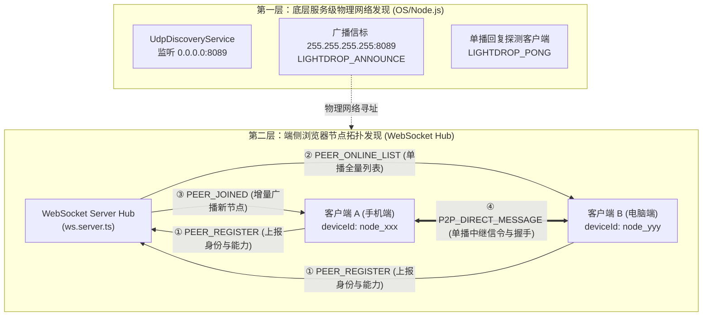
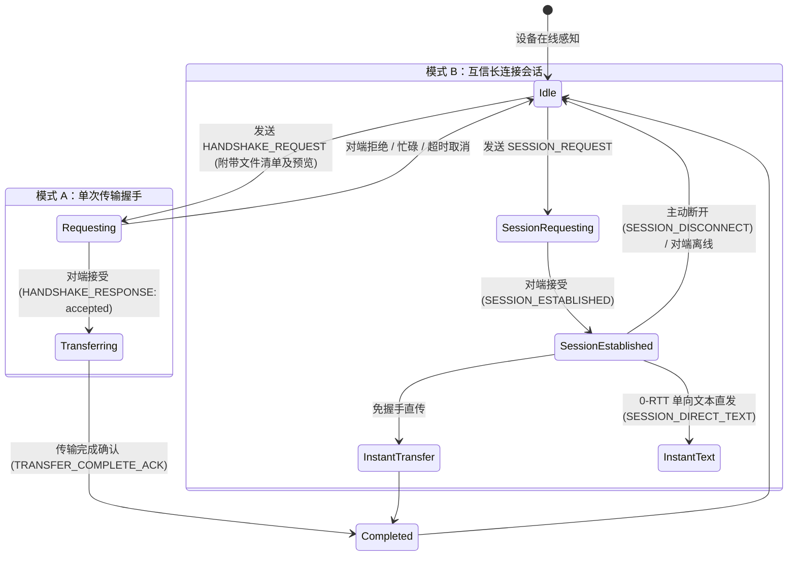
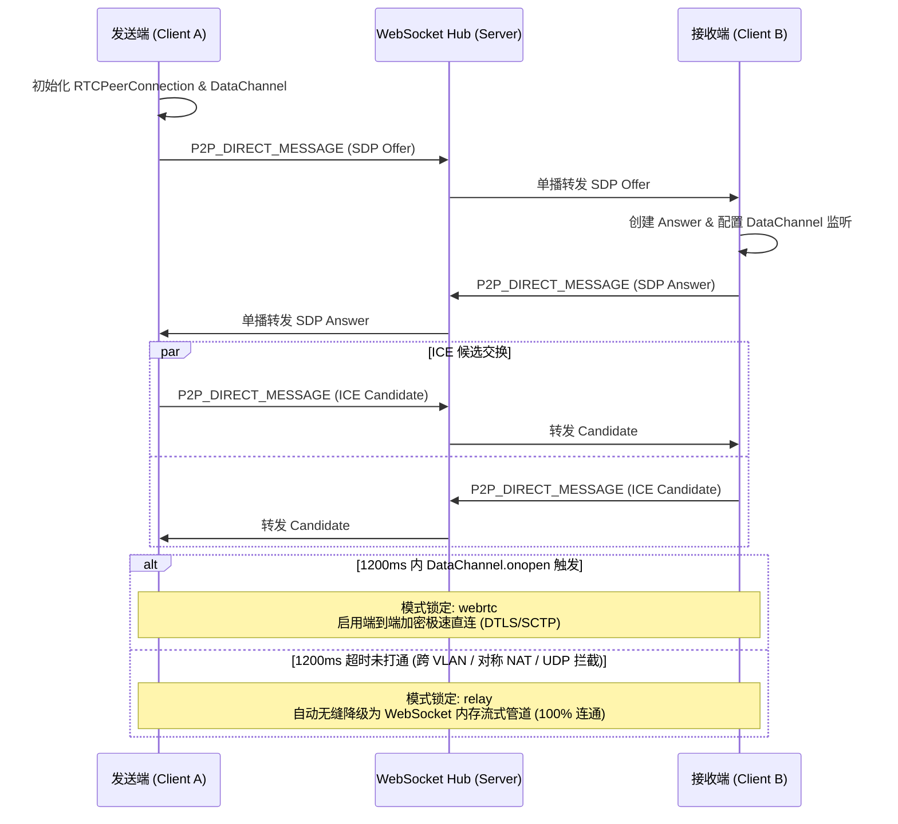
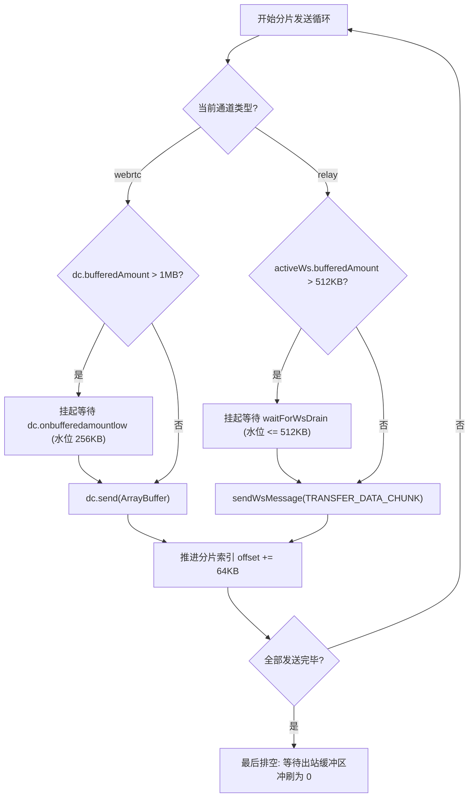
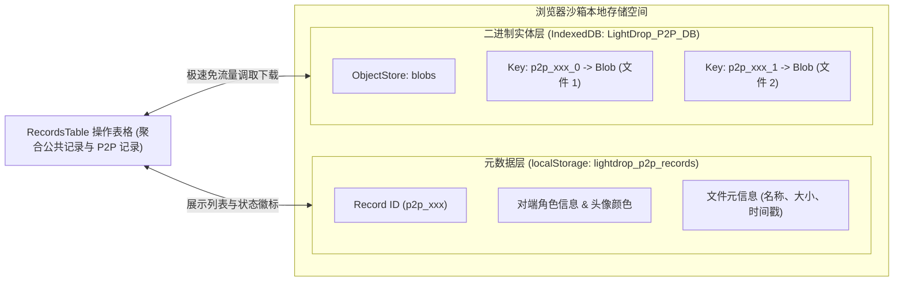

# LightDrop P2P 点对点传输与资源存储技术设计文档

> **版本**: v1.0.0  
> **语言**: 简体中文 | [English Version](./p2p-design_EN.md)  
> **更新时间**: 2026-10-30  
> **相关文档**: [系统整体技术架构与详细设计文档](./architecture.md)

---

## 📖 目录

- [1. 背景与核心挑战](#1-背景与核心挑战)
- [2. 两层分立的 P2P 设备发现模型](#2-两层分立的-p2p-设备发现模型)
  - [2.1 服务级物理网络发现 (UDP 广播信标 + mDNS)](#21-服务级物理网络发现-udp-广播信标--mdns)
  - [2.2 客户端浏览器拓扑协调 (WebSocket Hub)](#22-客户端浏览器拓扑协调-websocket-hub)
  - [2.3 广播风暴抑制与回环过滤机制](#23-广播风暴抑制与回环过滤机制)
- [3. 连接建立与信令协商机制](#3-连接建立与信令协商机制)
  - [3.1 握手交互状态机与长连接会话](#31-握手交互状态机与长连接会话)
  - [3.2 1.2 秒双轨自适应通道协商 (WebRTC + WebSocket Relay)](#32-12-秒双轨自适应通道协商-webrtc--websocket-relay)
- [4. 高性能双轨流式传输与流控流水线](#4-高性能双轨流式传输与流控流水线)
  - [4.1 64KB 流式分片与 ArrayBuffer 零拷贝](#41-64kb-流式分片与-arraybuffer-零拷贝)
  - [4.2 严格的双向背压控制 (Backpressure)](#42-严格的双向背压控制-backpressure)
  - [4.3 真实网卡出站速率测算与双端节流 ACK](#43-真实网卡出站速率测算与双端节流-ack)
  - [4.4 强一致性落盘确认协议](#44-强一致性落盘确认协议)
- [5. P2P 资源存储与无服务器管理方案](#5-p2p-资源存储与无服务器管理方案)
  - [5.1 零服务端物理落盘哲学 (Zero-Server-Disk-Retention)](#51-零服务端物理落盘哲学-zero-server-disk-retention)
  - [5.2 前端双层混合持久化架构 (IndexedDB + LocalStorage)](#52-前端双层混合持久化架构-indexeddb--localstorage)
  - [5.3 零网络开销本地资源导出与全生命周期回收](#53-零网络开销本地资源导出与全生命周期回收)

---

## 1. 背景与核心挑战

在纯浏览器 Web 环境下实现跨平台设备点对点极速直传，存在三大本质技术约束：
1. **沙箱网络权限约束**：浏览器安全模型禁止 JavaScript 直接创建原生 TCP/UDP 监听套接字（Listening Socket），无法在前端发起原生的局域网多播/广播嗅探；
2. **复杂局域网拓扑障碍**：多设备往往分布在双频 Wi-Fi（2.4GHz / 5GHz）、企业级跨 VLAN 子网或开启了客户端隔离（AP Isolation）的网络中，纯 WebRTC 打洞成功率无法达到 100%；
3. **大文件传输内存挤爆 (OOM)**：如果将数百 MB 或数 GB 级的大文件直接转成单一内存 Blob 或 Base64 字符串，会导致移动端浏览器标签页瞬时崩溃卡死。

针对上述难题，LightDrop 提出了**两层分立发现、双轨自适应通道、严格背压控制与前端 IndexedDB 混合存储**的技术解决方案。

---

## 2. 两层分立的 P2P 设备发现模型



### 2.1 服务级物理网络发现 (UDP 广播信标 + mDNS)

由服务端后台单例 [`UdpDiscoveryService`](../src/server/services/udp-discovery.service.ts) 驱动：
* **主动信标宣告**：服务启动或物理网卡 IP 发生变动（由 `NetworkWatcherService` 捕获）时，主动向全网广播地址 `255.255.255.255:8089` 发射信标报文：
  ```json
  {
    "event": "LIGHTDROP_ANNOUNCE",
    "service": "LightDrop",
    "instanceId": "c8a14b0e-9226-444a-b5a8-2b8e39f37c35",
    "ip": "192.168.1.105",
    "httpPort": 8080,
    "url": "http://192.168.1.105:8080",
    "bonjourHost": "mbp.local",
    "bonjourUrl": "http://mbp.local:8080",
    "timestamp": "2026-10-30T09:30:00.000Z"
  }
  ```
* **被动嗅探应答**：持续监听局域网内其他实例发出的探测包（包含 `DISCOVER`、`PING`、`SCAN`、`QUERY`），以 `LIGHTDROP_PONG` 单播回复探测源端口。

### 2.2 客户端浏览器拓扑协调 (WebSocket Hub)

在客户端接入层（[`useWebSocket.ts`](../src/client/hooks/useWebSocket.ts) 与 [`ws.server.ts`](../src/server/websocket/ws.server.ts)）：
1. **稳定身份生成**：首次访问时在 `localStorage` 生成持久化 `deviceId`（`node_<timestamp>_<random>`），并提取操作系统、浏览器标识、海绵宝宝角色昵称及接收模式状态；
2. **入网自声明**：连接成功后发送 `PEER_REGISTER`，服务端捕获底层 Socket 连接并注入其真实局域网 IP (`clientIp`)；
3. **拓扑全量下发与增量订阅**：
   * **全量单播**：仅向新加入节点单播下发当前在线设备列表（`PEER_ONLINE_LIST`）；
   * **增量广播**：向其他既有节点发送轻量 `PEER_JOINED` 增量事件；属性变动（如切换为接收模式）派发 `PEER_UPDATED`；离线（30s 心跳超时或主动关闭标签页）派发 `PEER_LEFT`。

### 2.3 广播风暴抑制与回环过滤机制

为杜绝网络风暴和高系统负载，UDP 发现模块部署了三道防御屏障：
1. **实例 UUID 防回环**：进程启动生成全局唯一 `instanceId`，报文如果包含自身 ID 则坚决抛弃，绝不处理；
2. **同客户端 IP 500ms 限流**：同 IP 在 500ms 窗口内仅响应 1 次，超出部分直接丢弃；
3. **接口缓存 TTL (5s)**：网卡列表与信标数据缓存 5 秒，彻底消除高频调用 `os.networkInterfaces()` 带来的系统态 CPU 消耗。

---

## 3. 连接建立与信令协商机制

### 3.1 握手交互状态机与长连接会话

LightDrop 设计了两种交互生命周期模型：



* **绝对单播信令中继**：所有握手控制报文均封装为 `P2P_DIRECT_MESSAGE` 并携带 `targetDeviceId`，服务端仅做内存透明单播转发，不会对无关设备产生广播干扰。

### 3.2 1.2 秒双轨自适应通道协商 (WebRTC + WebSocket Relay)

为了在极速与高连通性之间取得平衡，[`p2pEngine.ts`](../src/client/utils/p2p/p2pEngine.ts) 内置了**双轨通道智能竞速与降级引擎**：



---

## 4. 高性能双轨流式传输与流控流水线

### 4.1 64KB 流式分片与 ArrayBuffer 零拷贝

* 发送端通过 `file.slice(offset, offset + 64KB)` 逐块读取分片，从根源上杜绝大文件一次性进内存。
* **分片封装协议**：
  * **WebRTC 通道**：纯二进制 `ArrayBuffer` 零拷贝投递；控制信令（`FILE_START`、`FILE_END`、`COMPLETE`）以 JSON 文本混部在同一 DataChannel 中；
  * **Relay 通道**：二进制分片经轻量 Base64 编码，封装为 `TRANSFER_DATA_CHUNK` 上行至 WebSocket 服务端内存，服务端单播分发至对端，下行即刻还原为 `ArrayBuffer`。

### 4.2 严格的双向背压控制 (Backpressure)



该流控流水线保证：无论传输数 GB 的视频文件还是海量小图片，发送端与接收端的内存开销恒定限制在 **< 2MB**。

### 4.3 真实网卡出站速率测算与双端节流 ACK

传统 Web 传输往往将“已写入套接字发送缓冲区”误当作“已成功发送”，导致界面进度提前冲到 100% 出现虚假假死。
* **真实出站字节数计算**：
  $$\text{actualDeliveredBytes} = \max(0, \text{transferredBytes} - \text{bufferedAmount})$$
* **节流进度同步 (TRANSFER_ACK)**：
  接收端每间隔 300ms 且接收超过 256KB 时，向发送端单播回传真实的接收落盘进度，发送端校准自身瞬时速度与进度展示。

### 4.4 强一致性落盘确认协议

* 发送端完成全部物理数据发送后，界面**进度最高锁定在 99%**，绝不提前显示 100%；
* 接收端完成全量二进制分片的组装、校验并写入本地存储后，向发送端回复 `TRANSFER_COMPLETE_ACK`；
* 发送端收到此 ACK 后，双方才正式在界面触发 100% 完成动效与系统通知，协议层面根除单侧悬挂。

---

## 5. P2P 资源存储与无服务器管理方案

### 5.1 零服务端物理落盘哲学 (Zero-Server-Disk-Retention)

P2P 模式下传输的所有文件实体与富文本笔记：
* **绝不写入服务端磁盘**：服务端 `data/files/` 物理目录与 `records.json` 数据库内**没有任何明文或加密的留存记录**；
* 服务端在 Relay 模式下仅充当瞬间内存中继（Ephemeral Memory Relay），数据在 Node.js 事件循环的微任务中完成转发生命周期并被 V8 GC 立即回收，彻底杜绝数据在第三方硬件上被物理提取的风险。

### 5.2 前端双层混合持久化架构 (IndexedDB + LocalStorage)

为了让 P2P 接收的文件在刷新页面后依然可离线调取，系统在浏览器端设计了双层持久化引擎（[`p2pRecordStorage.ts`](../src/client/utils/p2p/p2pRecordStorage.ts)）：



1. **元数据层 (`localStorage`)**：存储体积轻量（<几KB）的传输摘要，使得 P2P 传输记录能与服务端的公共分享记录无缝聚合在同一个表格中展示，并带有醒目的 `P2P` 专有徽标。
2. **二进制实体层 (`IndexedDB`)**：文件传输完成（`completeP2PRecord`）后，底层自动开启只写事务，将文件二进制 Blob 依次以 `${recordId}_${fileIndex}` 为键写入 `LightDrop_P2P_DB` 的 `blobs` 对象仓库。此设计成功打破了 `localStorage` 5MB 的硬性体积上限，支持数 GB 级文件的离线安全持久留存。

### 5.3 零网络开销本地资源导出与全生命周期回收

* **零流量极速提取与下载**：
  用户在表格中点击“下载”或“查看”P2P 记录时，底层 Hooks（[`useRecords.ts`](../src/client/hooks/useRecords.ts)）检测到 `item.isP2P` 属性，直接通过 `getP2PRecordBlob()` 从 IndexedDB 读取二进制实体，并生成对象 URL（`URL.createObjectURL(blob)`）触发浏览器原生保存，**全程产生 0 外部网络流量，0 服务端负载**。
* **原子级生命周期清理**：
  * **单条级联删除**：调用 `deleteLocalP2PRecord(id)`，原子移除 `localStorage` 对应元数据，并循环删除 `IndexedDB` 中关联的全部文件 Blob 分块；
  * **一键排空缓存**：调用 `clearAllLocalP2PRecords()` 清空对象仓库；
  * **隐私沙箱隔离**：在浏览器隐私/无痕模式下使用时，窗口关闭时浏览器沙箱自动析构全部 IndexedDB 与 localStorage 数据，主机不留一丝痕迹。
