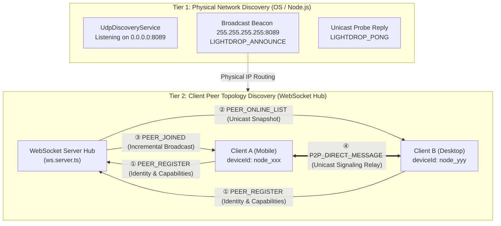
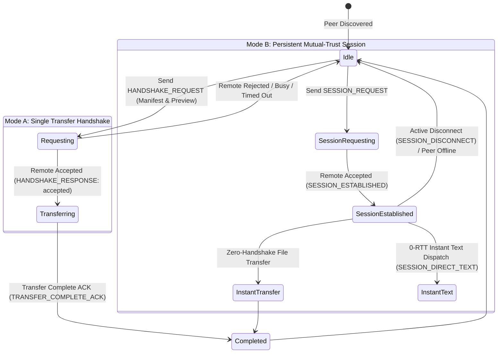
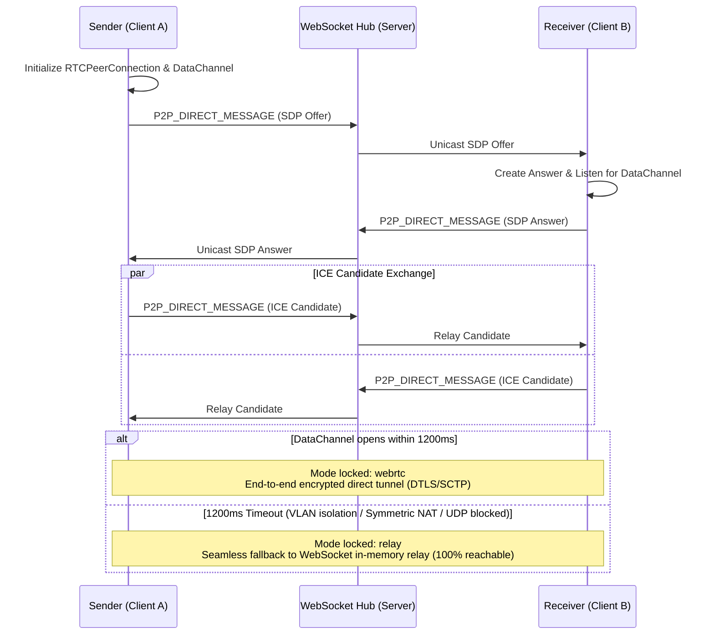
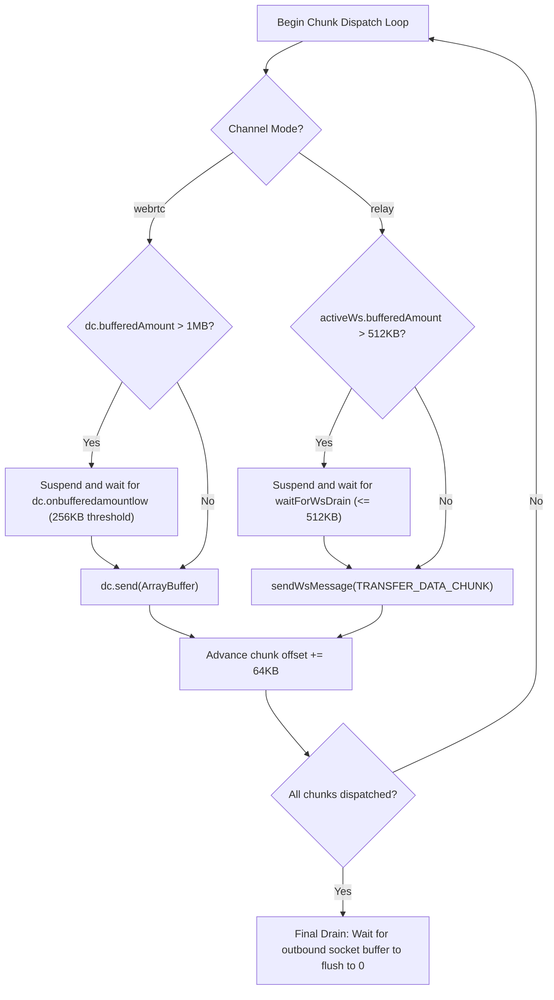
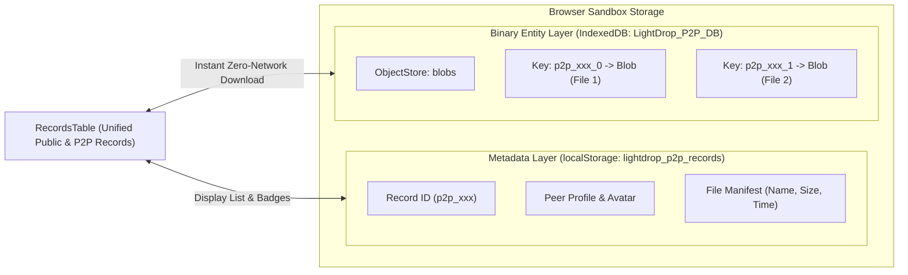

# LightDrop P2P Direct Transfer & Local Storage Technical Design Document

> **Version**: v1.0.0  
> **Language**: English | [简体中文](./p2p-design.md)  
> **Last Updated**: 2026-10-30  
> **Related Documents**: [System Architecture & Technical Design Document](./architecture_EN.md)

---

## 📖 Table of Contents

- [1. Background & Core Technical Challenges](#1-background--core-technical-challenges)
- [2. Two-Tier Decoupled P2P Device Discovery](#2-two-tier-decoupled-p2p-device-discovery)
  - [2.1 Service-Level Physical Network Discovery (UDP Beacon + mDNS)](#21-service-level-physical-network-discovery-udp-beacon--mdns)
  - [2.2 Client-Level Peer Topology Coordination (WebSocket Hub)](#22-client-level-peer-topology-coordination-websocket-hub)
  - [2.3 Storm Suppression & Loopback Filtering Mechanisms](#23-storm-suppression--loopback-filtering-mechanisms)
- [3. Connection Establishment & Signaling Protocol](#3-connection-establishment--signaling-protocol)
  - [3.1 Handshake State Machine & Persistent Sessions](#31-handshake-state-machine--persistent-sessions)
  - [3.2 1.2-Second Adaptive Dual-Channel Negotiation (WebRTC + WebSocket Relay)](#32-12-second-adaptive-dual-channel-negotiation-webrtc--websocket-relay)
- [4. High-Performance Dual-Channel Streaming & Flow Control](#4-high-performance-dual-channel-streaming--flow-control)
  - [4.1 64KB Chunking & Zero-Copy ArrayBuffer Dispatch](#41-64kb-chunking--zero-copy-arraybuffer-dispatch)
  - [4.2 Strict Dual-Sided Backpressure Control](#42-strict-dual-sided-backpressure-control)
  - [4.3 Real Outbound NIC Rate Calculation & Throttled Progress ACKs](#43-real-outbound-nic-rate-calculation--throttled-progress-acks)
  - [4.4 Strong Consistency Storage Commit Protocol](#44-strong-consistency-storage-commit-protocol)
- [5. P2P Resource Storage & Zero-Server Management Scheme](#5-p2p-resource-storage--zero-server-management-scheme)
  - [5.1 Zero-Server-Disk-Retention Privacy Philosophy](#51-zero-server-disk-retention-privacy-philosophy)
  - [5.2 Client-Side Hybrid Local Persistence (IndexedDB + LocalStorage)](#52-client-side-hybrid-local-persistence-indexeddb--localstorage)
  - [5.3 Zero-Network Local Export & Full Lifecycle Disposal](#53-zero-network-local-export--full-lifecycle-disposal)

---

## 1. Background & Core Technical Challenges

Implementing high-speed peer-to-peer file transfer in pure browser environments involves three intrinsic technical barriers:
1. **Browser Sandbox Permissions**: The browser security sandbox strictly prohibits JavaScript from opening native TCP/UDP listening sockets, rendering raw LAN broadcast/multicast scanning impossible;
2. **Heterogeneous Network Topologies**: Devices frequently reside across dual-band Wi-Fi channels (2.4GHz vs 5GHz), partitioned VLANs, or under AP isolation policies, preventing 100% WebRTC direct hole-punching success;
3. **Memory Bloat & Tab Crashes (OOM)**: Converting multi-hundred-megabyte or gigabyte files into a monolithic in-memory Blob or Base64 string inevitably triggers browser tab freezes or instant crashes on mobile devices.

To overcome these constraints, LightDrop combines **two-tier decoupled discovery, dual-channel adaptive streaming, fine-grained backpressure flow control, and client-side IndexedDB persistence**.

---

## 2. Two-Tier Decoupled P2P Device Discovery



### 2.1 Service-Level Physical Network Discovery (UDP Beacon + mDNS)

Driven by the background service singleton [`UdpDiscoveryService`](../src/server/services/udp-discovery.service.ts):
* **Active Beacon Announcement**: On startup or upon hardware network interface transitions (intercepted by `NetworkWatcherService`), it broadcasts a beacon packet to `255.255.255.255:8089`:
  ```json
  {
    "event": "LIGHTDROP_ANNOUNCE",
    "service": "LightDrop",
    "instanceId": "c8a14b0e-9226-444a-b5a8-2b8e39f37c35",
    "ip": "192.168.1.105",
    "httpPort": 8080,
    "url": "http://192.168.1.105:8080",
    "bonjourHost": "mbp.local",
    "bonjourUrl": "http://mbp.local:8080",
    "timestamp": "2026-10-30T09:30:00.000Z"
  }
  ```
* **Passive Probe Responses**: Continuously responds to incoming queries (`DISCOVER`, `PING`, `SCAN`, `QUERY`) by unicasting a `LIGHTDROP_PONG` back to the sender.

### 2.2 Client-Level Peer Topology Coordination (WebSocket Hub)

Operates within the browser client layer ([`useWebSocket.ts`](../src/client/hooks/useWebSocket.ts) and [`ws.server.ts`](../src/server/websocket/ws.server.ts)):
1. **Stable Device Fingerprinting**: Stores a persistent `deviceId` (`node_<timestamp>_<random>`) in `localStorage`, binding the host OS, browser family, SpongeBob avatar, and operating mode;
2. **Online Declaration**: Emits `PEER_REGISTER` upon connecting. The server captures the socket connection and injects the client's verified LAN IP (`clientIp`);
3. **Full Snapshot & Incremental Subscription**:
   * **Full Unicast**: Unicasts the active peer snapshot (`PEER_ONLINE_LIST`) strictly to the joining node;
   * **Incremental Broadcast**: Notifies existing nodes via lightweight `PEER_JOINED` events. State modifications trigger `PEER_UPDATED`; disconnections trigger `PEER_LEFT`.

### 2.3 Storm Suppression & Loopback Filtering Mechanisms

1. **Instance UUID Echo Filtering**: Prevents loopback amplification by generating a process-unique `instanceId` and ignoring self-originated beacons;
2. **500ms IP Rate-Limiting**: Caps responses to the same remote IP to at most once per 500ms window;
3. **5-Second Interface Cache TTL**: Eliminates high kernel CPU overhead by caching network interface queries for 5 seconds.

---

## 3. Connection Establishment & Signaling Protocol

### 3.1 Handshake State Machine & Persistent Sessions

LightDrop supports two connection paradigms:



* **Exact Unicast Signaling Relay**: All handshake messages are tagged with `targetDeviceId` as `P2P_DIRECT_MESSAGE`. The server performs transparent in-memory routing, avoiding broadcast disturbance.

### 3.2 1.2-Second Adaptive Dual-Channel Negotiation (WebRTC + WebSocket Relay)

[`p2pEngine.ts`](../src/client/utils/p2p/p2pEngine.ts) features an **adaptive dual-channel racing engine**:



---

## 4. High-Performance Dual-Channel Streaming & Flow Control

### 4.1 64KB Chunking & Zero-Copy ArrayBuffer Dispatch

* Files are sliced sequentially via `file.slice(offset, offset + 64KB)`, preventing large files from entering memory at once.
* **Encapsulation Protocol**:
  * **WebRTC Channel**: Binary `ArrayBuffer` payloads stream with zero-copy; control headers (`FILE_START`, `FILE_END`, `COMPLETE`) multiplex over the same DataChannel as JSON strings;
  * **Relay Channel**: Binary chunks are Base64-encoded, wrapped in `TRANSFER_DATA_CHUNK`, and streamed through WebSocket server memory directly to the recipient.

### 4.2 Strict Dual-Sided Backpressure Control



This ensures that whether transmitting gigabyte-sized videos or thousands of images, browser memory remains tightly capped at **< 2MB**.

### 4.3 Real Outbound NIC Rate Calculation & Throttled Progress ACKs

Traditional web transfers often mistake buffered bytes for delivered bytes. LightDrop calculates true physical delivery:
$$\text{actualDeliveredBytes} = \max(0, \text{transferredBytes} - \text{bufferedAmount})$$

The receiver throttles progress ACKs (`TRANSFER_ACK`) back to the sender every 300ms or 256KB to align real-time transfer speeds and progress bars.

### 4.4 Strong Consistency Storage Commit Protocol

* The sender's progress **caps at 99%** upon emitting all bytes;
* The receiver verifies and commits all blobs to local storage, then returns `TRANSFER_COMPLETE_ACK`;
* Only upon receiving this ACK do both clients trigger 100% completion callbacks, eliminating single-sided hanging states.

---

## 5. P2P Resource Storage & Zero-Server Management Scheme

### 5.1 Zero-Server-Disk-Retention Privacy Philosophy

* P2P files and text snippets **never touch the server's disk storage** (`data/files/` and `records.json` contain zero traces);
* In Relay mode, server memory acts strictly as an ephemeral conduit, immediately garbage-collected by the V8 runtime.

### 5.2 Client-Side Hybrid Local Persistence (IndexedDB + LocalStorage)

[`p2pRecordStorage.ts`](../src/client/utils/p2p/p2pRecordStorage.ts) implements client-side dual-layer storage:



1. **Metadata Layer (`localStorage`)**: Stores lightweight summaries (< a few KBs), enabling P2P records to blend seamlessly into the main dashboard table with distinct `P2P` badges.
2. **Binary Blob Layer (`IndexedDB`)**: Binary blobs are written to `LightDrop_P2P_DB` (`blobs` object store, keyed by `${recordId}_${fileIndex}`). This bypasses the 5MB `localStorage` limit, supporting gigabyte-scale offline persistence.

### 5.3 Zero-Network Local Export & Full Lifecycle Disposal

* **Zero-Network Downloads**: Clicking "Download" or "View" on a P2P record intercepts the `isP2P` flag, retrieves the Blob from IndexedDB via `getP2PRecordBlob()`, and triggers a native download via `URL.createObjectURL(blob)`, **consuming 0 server compute and 0 external network traffic**.
* **Atomic Deletion**: Deleting a record atomically removes the metadata from `localStorage` and purges all corresponding `IndexedDB` binary blobs.
* **Sandbox Disposal**: In Incognito mode, closing the browser automatically purges all IndexedDB and localStorage data without leaving trace evidence on the host machine.
